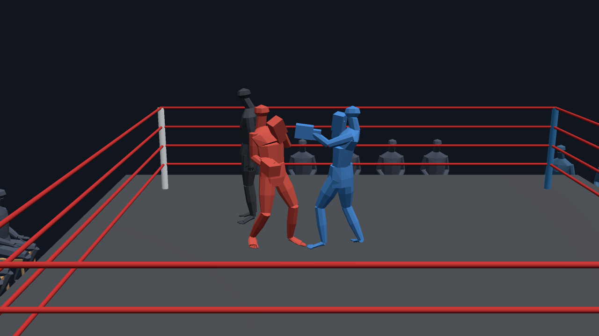
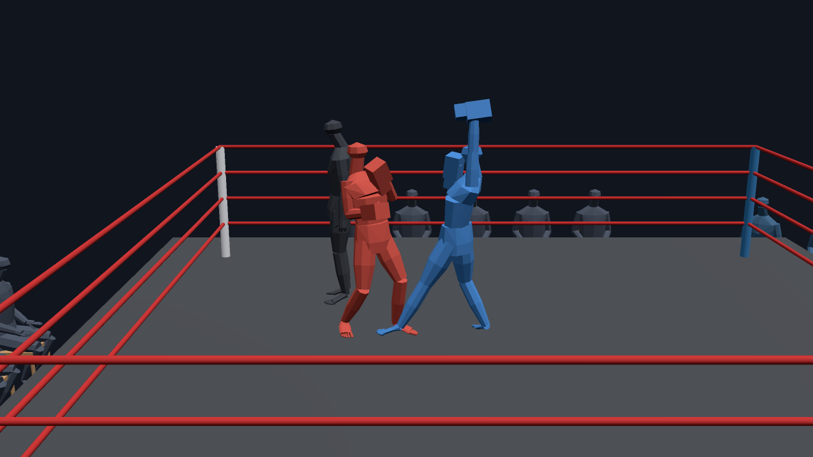
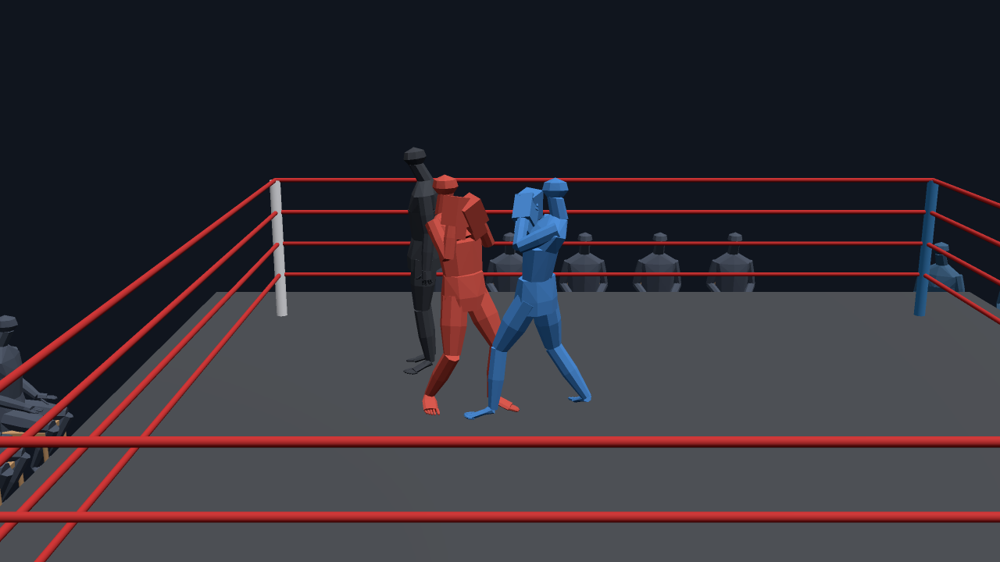
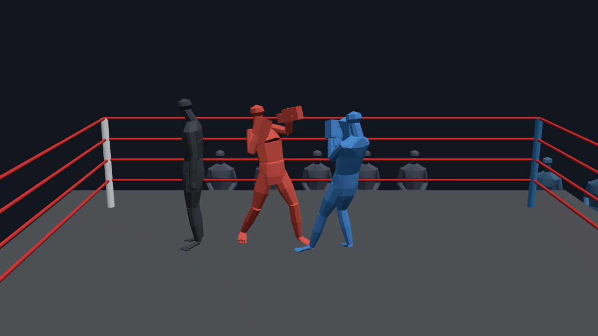
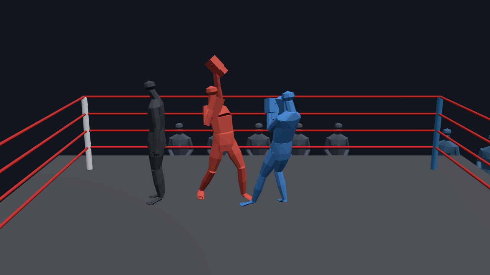
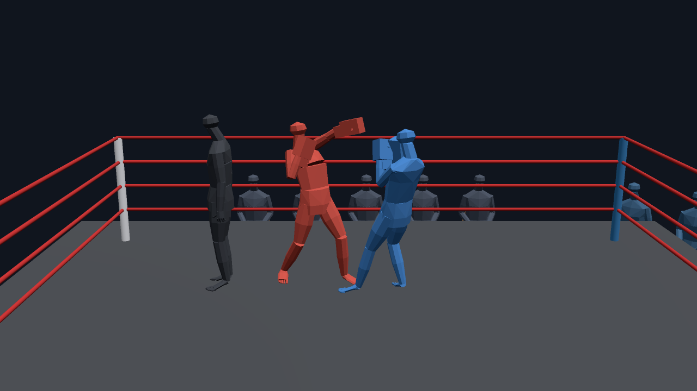
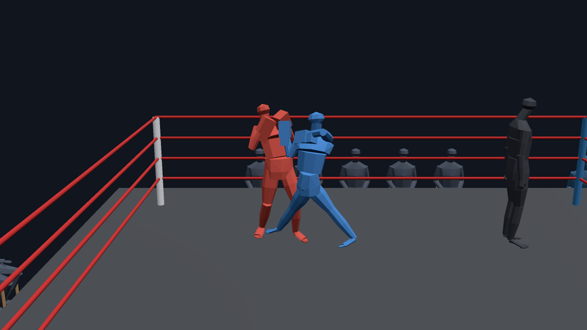
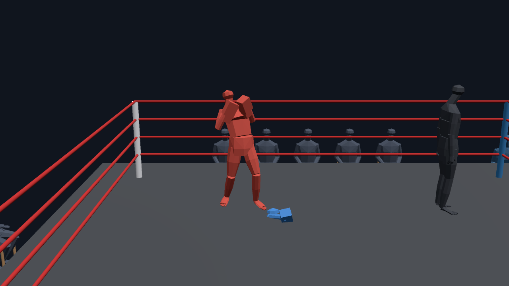
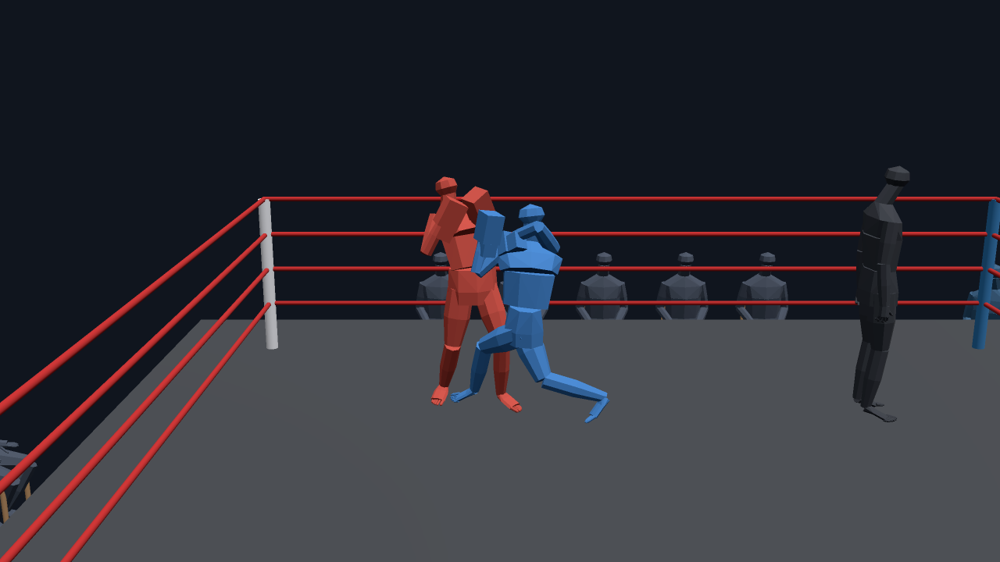

# Native pose discontinuities

The complete source inspection `whole-round-001` drew 2996/2996 cells at 1280 by 720 through the film and fixed high-oblique views. All 125 sheets and the full-size examples below were read. These are observations of the installed native performance, retained under the user's instruction to complete the film with the package's limitations. They are not accepted athletic motion. The owner report is [#3576](https://github.com/samchon/automovie/issues/3576).

## Identity and reproduction

The installed packages are AutoMovie 0.2.0 with the examples workspace's recorded pnpm patches. `pnpm run film:bake` resolves the complete graph and samples the SDK's own poses. The browser reads those native clips through `sampleMotion`, without a local pose correction, authored joint keys or dynamic simulation.

The input digest is `9e8d3adabbce22f0fd57fbbf18a6fa792bec09ce52871a42cdf3671a4e33e1a1`; the actual native output SHA-256 is `e131fecc7ebd2b950242ecb6065f7a013c44c934f7ed92ca6f21a4091e535032`. [The excerpt](native-continuity.json) copies the relevant native keys and overlapping schedule entries. Picture seconds equal native seconds minus the one-second guard preparation.

## Observations

| Performer and picture frame | Observation in the actual native data and still |
| --- | --- |
| Marek F657 to F658, 21.900 to 21.933333 s | Left upper-arm flexion changes from 50.5113 to 159.4468 degrees in one 30 Hz step; the glove rises above the head during a punch exchange. |
| Owen F1496 to F1498, 49.866667 to 49.933333 s | Left upper-arm flexion changes from 50.6764 to 145.8545 degrees; the arm rises overhead and returns during the exchange. |
| Marek F2457 to F2458, 81.900 to 81.933333 s | Root Y changes from -0.1241161 to -1.7035627 m in one step, a -1.5794466 m displacement. Almost the entire blue figure disappears below the canvas. At F2460, 82.000 s, root Y has returned to -0.2200119 m. No knockdown is authored in this passage. |

The arm excursion is related in appearance to the already closed [#3400](https://github.com/samchon/automovie/issues/3400); this observation does not establish the same implementation cause. The demonstrated boundary is the complete native action/defence composition's sampled pose, before rendering. Its root and joint values already contain the discontinuities, so camera framing and MP4 encoding cannot cause them. Which native solver or transition introduces them remains for the package owner to isolate.

## Other production observations

Standing exchanges concentrate near the centre and northwest quadrant; the written red and blue corner visits are not realized. The current production composes relative stance steps, which do not establish those world landmarks. Official travel also crosses the fighting area and briefly obscures the fighters near 60–63 and 109–110 seconds. In the ending he kneels at a separate landmark and does not establish the authored supporting contact with the fallen fighter. These are production staging limitations; the inspection does not assign them to an SDK defect.

The original closing camera lost the winner during his neutral-corner stay. The production camera now reframes to the whole ring before that stay, without changing the native poses. The affected 133–180 second capture `closing-framing-002` completed 554/554 cells; all 24 sheets were read and retain the winner, fallen fighter and official through the ending. This repairs the framing, without accepting the motions. The existing seated/supine lie-down and head-count fallback remain disclosed in the [delivery record](kickboxing.md).
