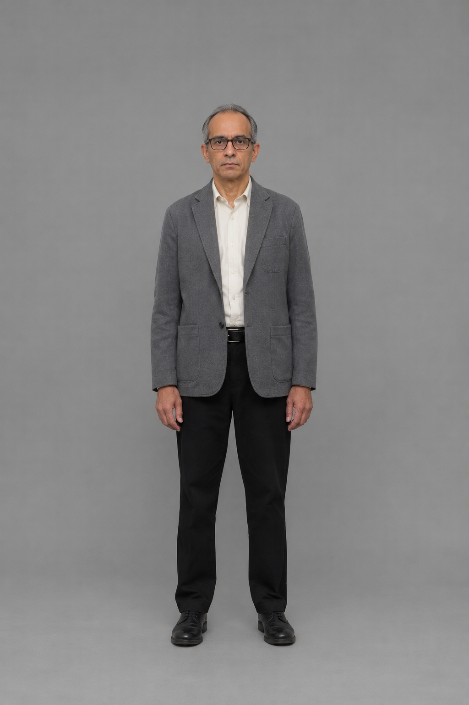

# Alan Price

## Identity and table work {#identity-and-table-work}

### Timekeeper {#timekeeper}

Alan is 58 and lean, with light brown skin, receding dark-grey short hair and rectangular dark glasses. He wears a plain mid-grey jacket over an off-white shirt, black trousers and black shoes. His seat, striker and bell are at the near white corner.

The client's delegated representative compared these two generated photographs of Alan and adopted them as production references. The client has yet to ratify them personally. [Cast appearance commission](../../../instructions/cast-appearance.md) · [Casting photographs](../../../prompts/casting/photographs.md)

### Reading the referee {#reading-the-referee}

From below the apron Alan has to tip his head back to follow two fighters passing his table. Across the diagonal he can read the referee's signal above the rope. Alan has charge of the bell. He keeps the striker flat on the table where he can find it by touch, with his eyes still on the ring. [Stoppage procedure](../../../research/kickboxing/round-practice.md#rules-and-procedure)
