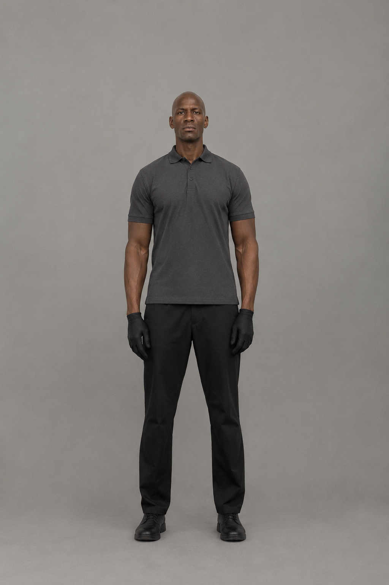
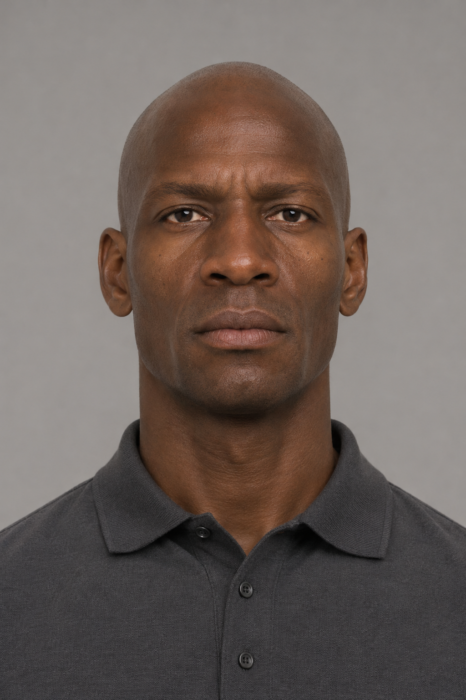

# Daniel Mensah

## Identity and authority {#identity-and-authority}

### Referee {#referee}

Daniel is 46, from Ghana, tall and straight-backed, with dark brown skin, a shaved head and high cheekbones. He wears a charcoal short-sleeved polo, black trousers, black gloves and flat black shoes, all plain. Of the three men in the ring, he alone has shod heels. Their sound can locate him before his hand comes into view.

The client's delegated representative compared these two generated photographs of Daniel and adopted them as production references. The client has yet to ratify them personally. [Cast appearance commission](../../../instructions/cast-appearance.md) · [Casting photographs](../../../prompts/casting/photographs.md)

### Working official {#working-official}

Daniel makes a command reach its recipient. His point gives a fighter a destination; the sweep of his arms can be read at the bell table. When a fighter is down, Daniel gets to the man's level and into his view. Play the count at an even cadence. He can assess the man in front of him and signal across the ring while keeping his attention close. His speaking voice is plain and carries. [Referee and count procedure](../../../research/kickboxing/round-practice.md#rules-and-procedure)
