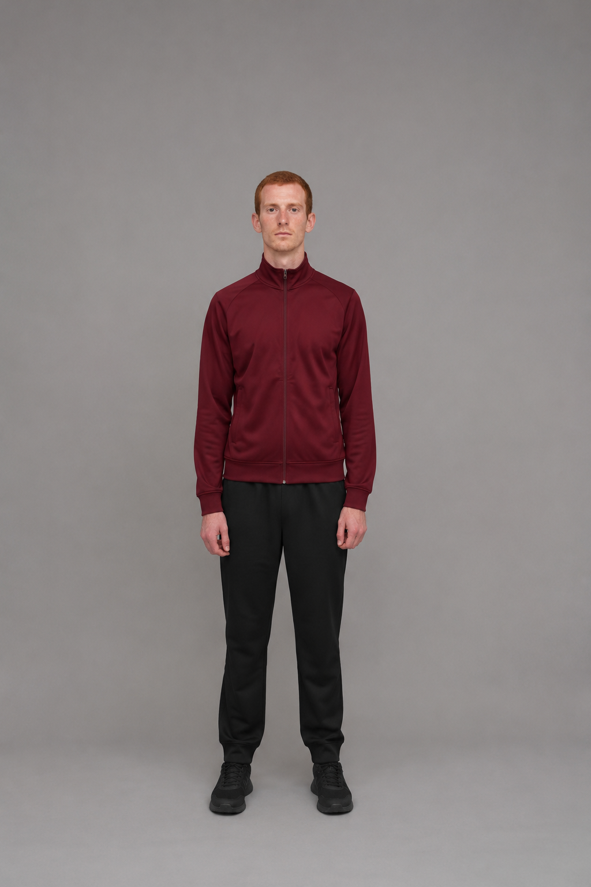
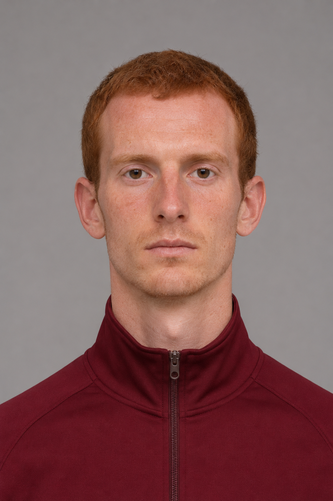

# Ed Lane

## Identity and corner work {#identity-and-corner-work}

### Red assistant second {#assistant-second}

Ed is 33, lanky, with light skin and cropped copper hair. He wears an all-dark-red zipped track top with black track trousers and black trainers, all plain. He sits beside Jo outside the red corner.

The client's delegated representative compared these two generated photographs of Ed and adopted them as production references. The client has yet to ratify them personally. [Cast appearance commission](../../../instructions/cast-appearance.md) · [Casting photographs](../../../prompts/casting/photographs.md)

### Stool and lower rope {#stool-and-lower-rope}

Ed looks after the corner stool, keeping it clear of the apron and close to his shins. From a low seat beside the pad he can lose the fighters' faces entirely. Through the gap under the bottom rope he can still follow a pair of feet. He's generous with his applause when Owen makes ground.
