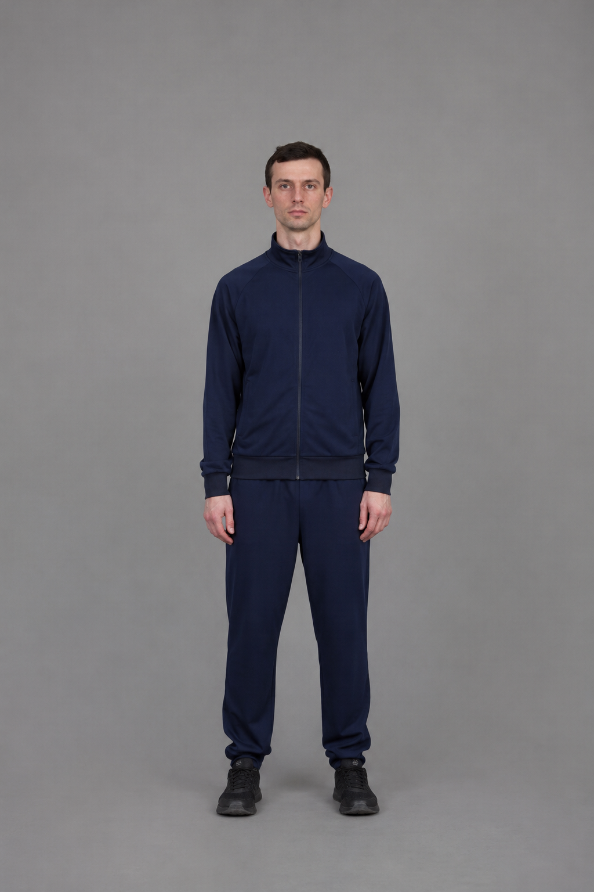
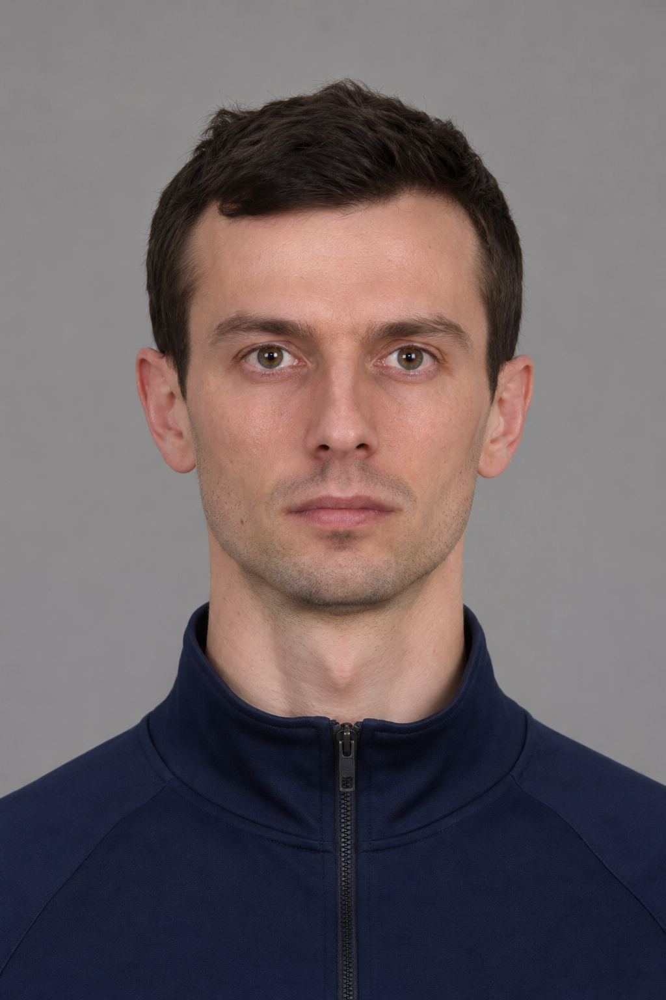

# Ivo Kral

## Identity and corner work {#identity-and-corner-work}

### Blue assistant second {#assistant-second}

Ivo is 34, slim, with fair skin and short dark hair. He wears a plain solid navy track jacket and trousers with black trainers. His sleeves are navy to the cuffs. He sits outside the blue pad with Pavel.

The client's delegated representative compared these two generated photographs of Ivo and adopted them as production references. The client has yet to ratify them personally. [Cast appearance commission](../../../instructions/cast-appearance.md) · [Casting photographs](../../../prompts/casting/photographs.md)

### Keeping the corner ready {#keeping-the-corner-ready}

Ivo has the towel on his knee. He can put it in order by touch and spare his eyes for the ring. With Pavel watching from the north edge of the pad, Ivo looks past the other edge. He gets a clear view of a man coming away from the corner and can lose a gesture made on Pavel's side. He has charge of the corner equipment whenever Pavel's attention is elsewhere.
