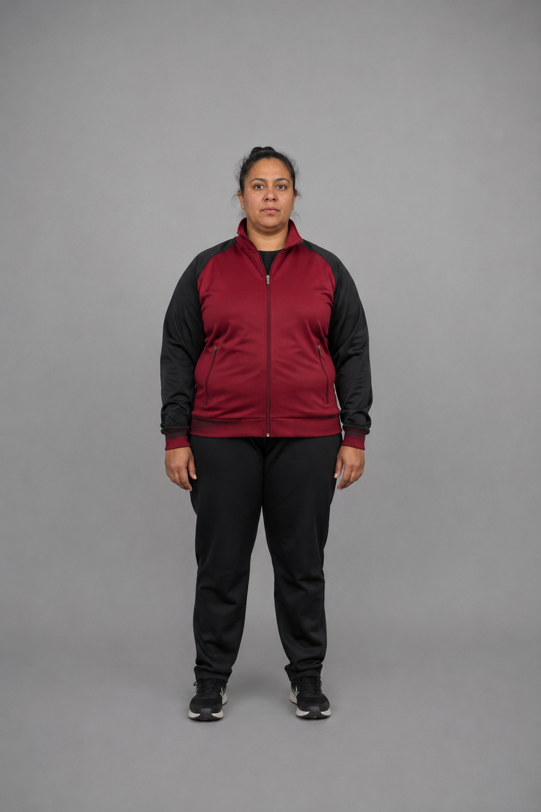
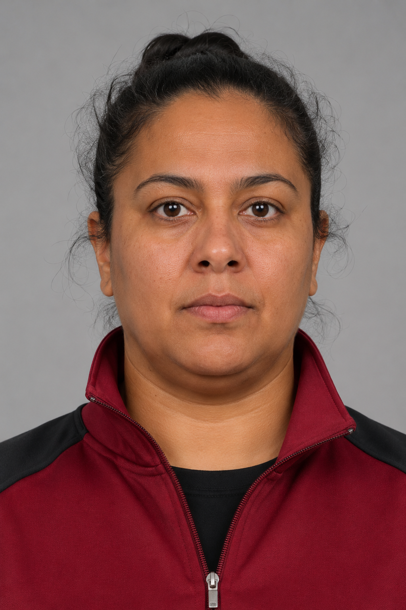

# Jo Bell

## Identity and corner work {#identity-and-corner-work}

### Red chief second {#chief-second}

Jo is 42, stout, with brown skin and black hair tied in a short bun. She wears a deep red track jacket with black sleeves, black track trousers and black trainers, all plain. Her seat is outside the ropes at the red pad.

The client's delegated representative compared these two generated photographs of Jo and adopted them as production references. The client has yet to ratify them personally. [Cast appearance commission](../../../instructions/cast-appearance.md) · [Casting photographs](../../../prompts/casting/photographs.md)

### Keeping sight of Owen {#keeping-sight-of-owen}

From her seat Jo watches Owen past the edge of the pad. An advancing back or a length of rope coming out at her can take away the very view she wants. Play the little changes of height as she recovers her sightline. She puts her hands together readily when she's seen Owen make ground. His salute has a definite address in her corner.
