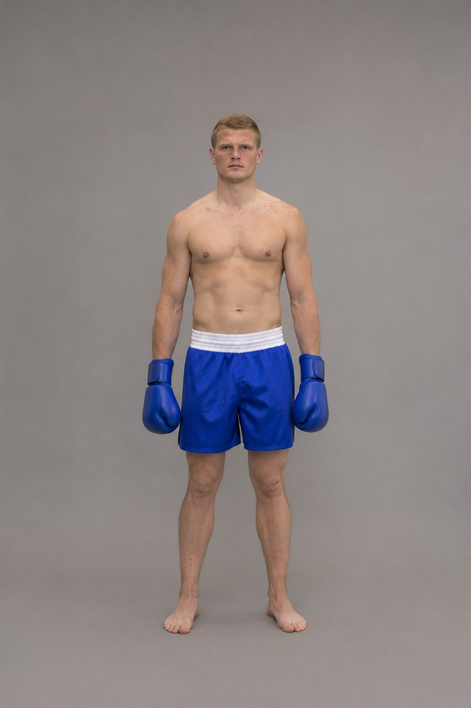
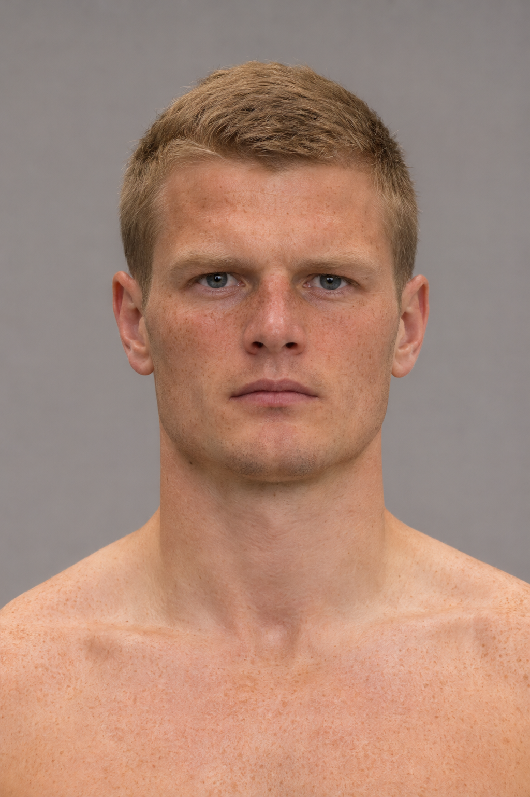

# Marek Sokol

## Identity and fighting style {#identity-and-style}

### Blue corner {#blue-corner}

Marek is 30 and from Czechia. He contests the championship on equal physical terms with Owen Vale. Each stands 180 cm and weighs 80 kg. Equally athletic, Marek has fair freckled skin, short sandy-blond hair, a broad square face and light brows. He is clean-shaven. Cast him bare-chested and barefoot in plain royal-blue shorts with a white waistband and matching blue gloves.

The championship commission fixes Marek's height and weight. [Fighters](../../../instructions/commission.md#fighters) The client's delegated representative compared these two generated photographs of Marek and adopted them as production appearance references. The client has yet to ratify them personally. [Cast appearance commission](../../../instructions/cast-appearance.md) · [Casting photographs](../../../prompts/casting/photographs.md)

### Pressure fighter {#pressure-fighter}

Marek likes the middle. He can make another man travel a long way round a very small patch of canvas. Once he sets off after somebody, he likes to choose where the walk ends. Give him a different quality of stillness when the choice is taken out of his hands. He has a private courtesy with his chief second, Pavel. One raised glove and a small outward turn are enough. He looks for Pavel's open hand in return.
