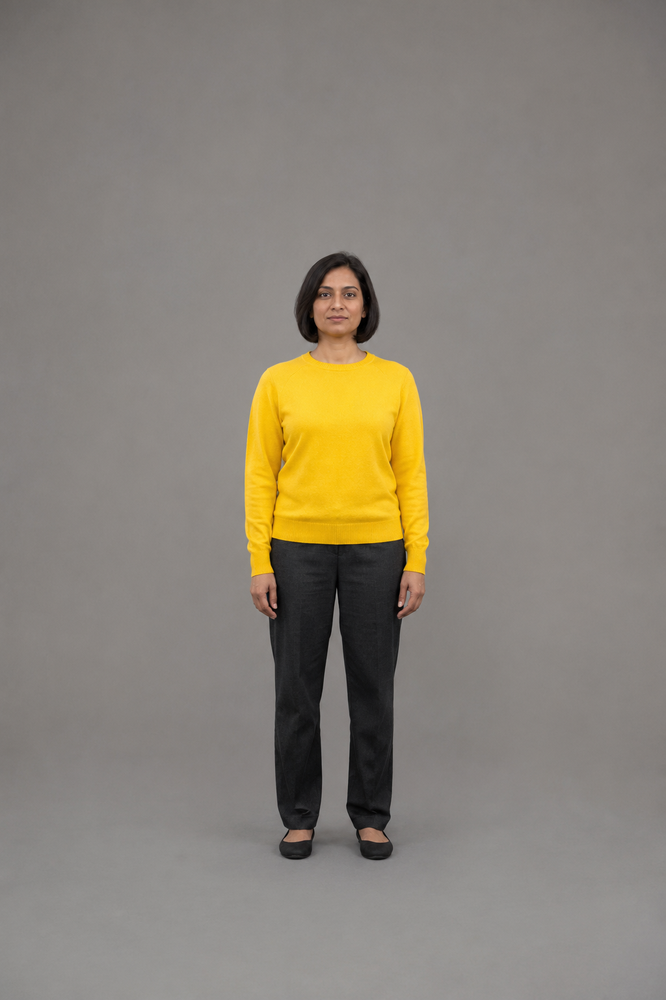
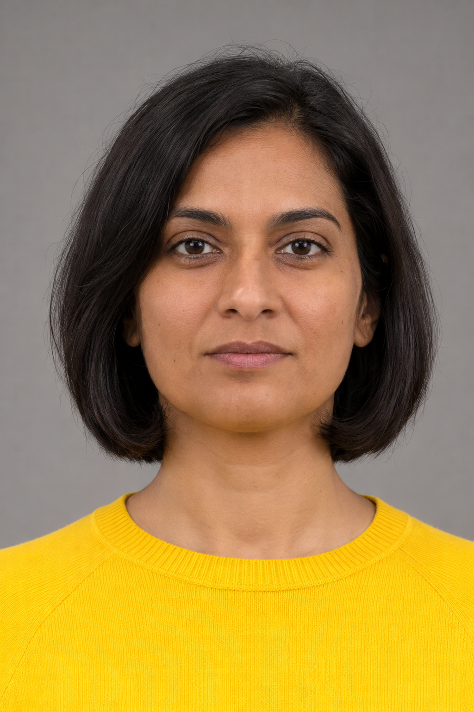

# Maya Shah

## Identity and ringside presence {#identity-and-ringside-presence}

### Ringside neighbour {#ringside-neighbour}

Maya is 37, with medium brown skin and a blunt chin-length black bob. She wears a plain sunflower-yellow long-sleeved crew-neck jumper, charcoal trousers and dark flat shoes. She sits on the east side near the bell table with Ruth beside her. Give the yellow upper body room to turn while she stays seated.

The client's delegated representative compared these two generated photographs of Maya and adopted them as production references. The client has yet to ratify them personally. [Cast appearance commission](../../../instructions/cast-appearance.md) · [Casting photographs](../../../prompts/casting/photographs.md)

### Following the ground {#following-the-ground}

Maya listens with her hands half ready to clap. A sharp sound and a man coming towards her can look like his moment. Once she has watched a man lose ground to that very sound, she takes longer. Let the direction of her shoulders and the place where her hands meet tell us whose effort she's following. Her eye can travel beyond the nearest pair of raised gloves.
