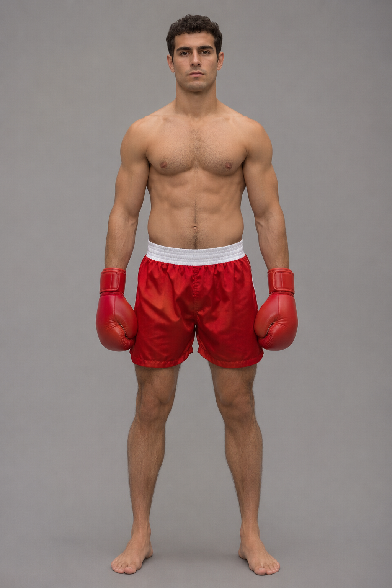
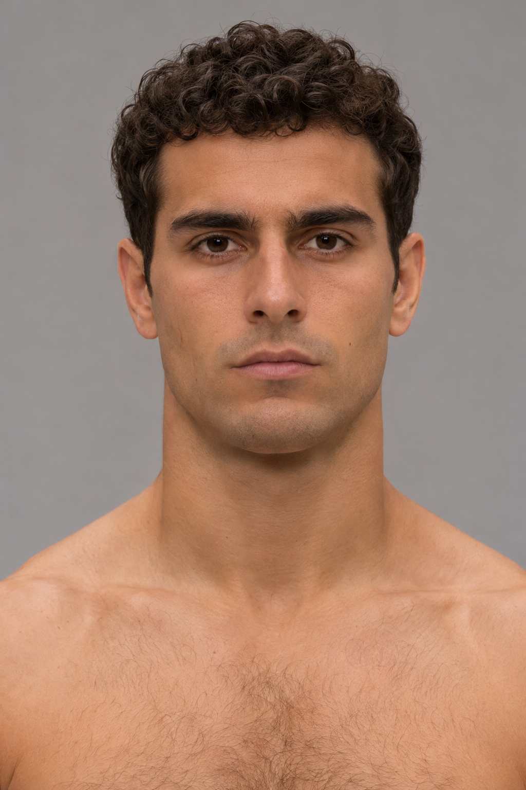

# Owen Vale

## Identity and fighting style {#identity-and-style}

### Red corner {#red-corner}

Owen is 29 and from the United Kingdom. He contests the championship on equal physical terms with Marek Sokol. Each stands 180 cm and weighs 80 kg. Compact and athletic, he has warm olive skin, close-cropped dark brown curls, an oval face and heavy straight brows. He is clean-shaven. Cast him bare-chested and barefoot in plain scarlet shorts with a straight white waistband and matching red gloves. The scarlet carries across the whole ring.

The championship commission fixes Owen's height and weight. [Fighters](../../../instructions/commission.md#fighters) The client's delegated representative compared these two generated photographs of Owen and adopted them as production appearance references. The client has yet to ratify them personally. [Cast appearance commission](../../../instructions/cast-appearance.md) · [Casting photographs](../../../prompts/casting/photographs.md)

### Patient kicker {#patient-kicker}

Owen can stand still for a whole breath and let someone come to him. Given room to go forward, he hurries; people who like him can find themselves cheering before he's won the ground. Show the cost of travelling in the changing length and sound of his steps. His courtesy is quite ordinary, an offered glove before he settles to work. When there's something to celebrate, let him have the full height of both red gloves.
