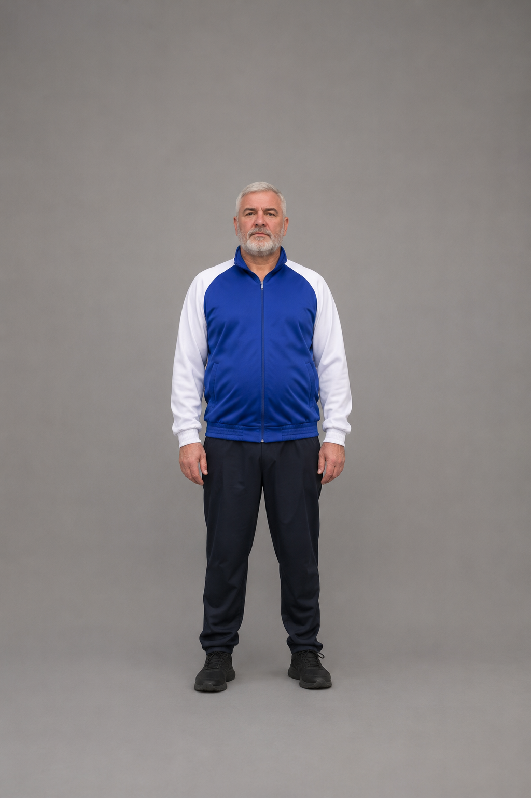
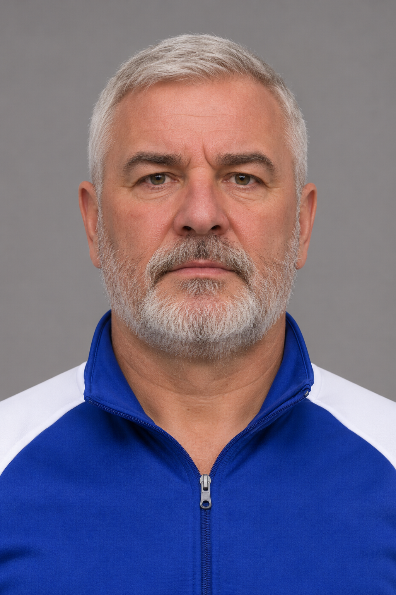

# Pavel Havel

## Identity and corner work {#identity-and-corner-work}

### Blue chief second {#chief-second}

Pavel is 53, broad-set and light-skinned, with short silver hair and a close silver beard. His plain royal-blue track jacket has completely white sleeves from shoulder to cuff. He wears dark track trousers and plain black trainers. He sits outside the north rope beside the blue pad, with a clear aisle towards far white. Pavel alone wears white sleeves.

The client's delegated representative compared these two generated photographs of Pavel and adopted them as production references. The client has yet to ratify them personally. [Cast appearance commission](../../../instructions/cast-appearance.md) · [Casting photographs](../../../prompts/casting/photographs.md)

### Answering hand {#answering-hand}

Pavel keeps Marek's face in sight when the pad allows it. Their greeting works across a rope. Marek turns one raised blue glove towards him; Pavel lifts one open palm so the white sleeve shows all the way to the wrist. Give the man time to see the answer. Pavel can bring his broad frame down quite low when the glove is close to the floor.
