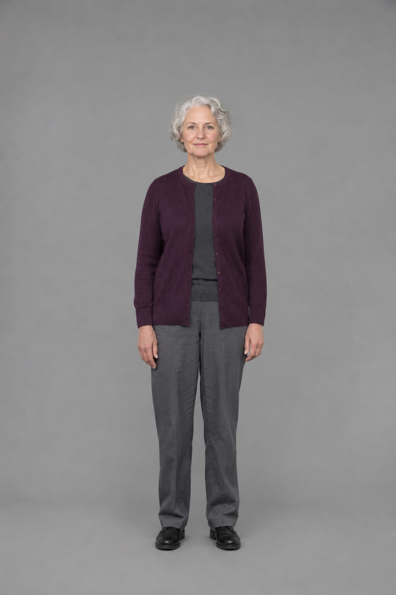
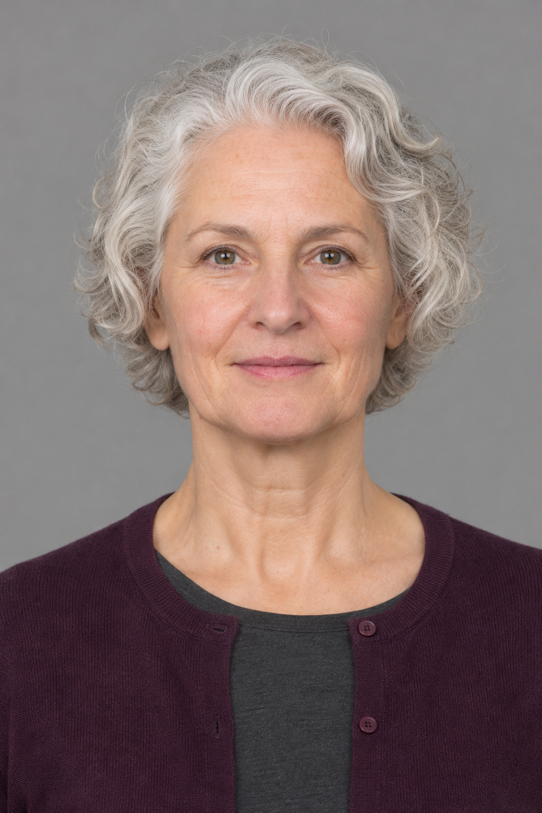

# Ruth Ellis

## Identity and ringside presence {#identity-and-ringside-presence}

### Ringside neighbour {#ringside-neighbour}

Ruth is 62, with fair skin and short silver curls. She wears a plain plum cardigan over a charcoal shirt, slate trousers and black shoes. Her hands are bare. She sits alongside Maya near the white corner on the east side. From there she can see her neighbour in profile and, by leaning, the canvas across the ring.

The client's delegated representative compared these two generated photographs of Ruth and adopted them as production references. The client has yet to ratify them personally. [Cast appearance commission](../../../instructions/cast-appearance.md) · [Casting photographs](../../../prompts/casting/photographs.md)

### Taking her own look {#taking-her-own-look}

Ruth readily picks up the time of another person's clap. Her sideways look at the opening hands makes that social impulse visible. For a response of her own, give her time to lean, find the person and settle facing them. A single clap of her bare hands is distinct at the nearby bell table.
