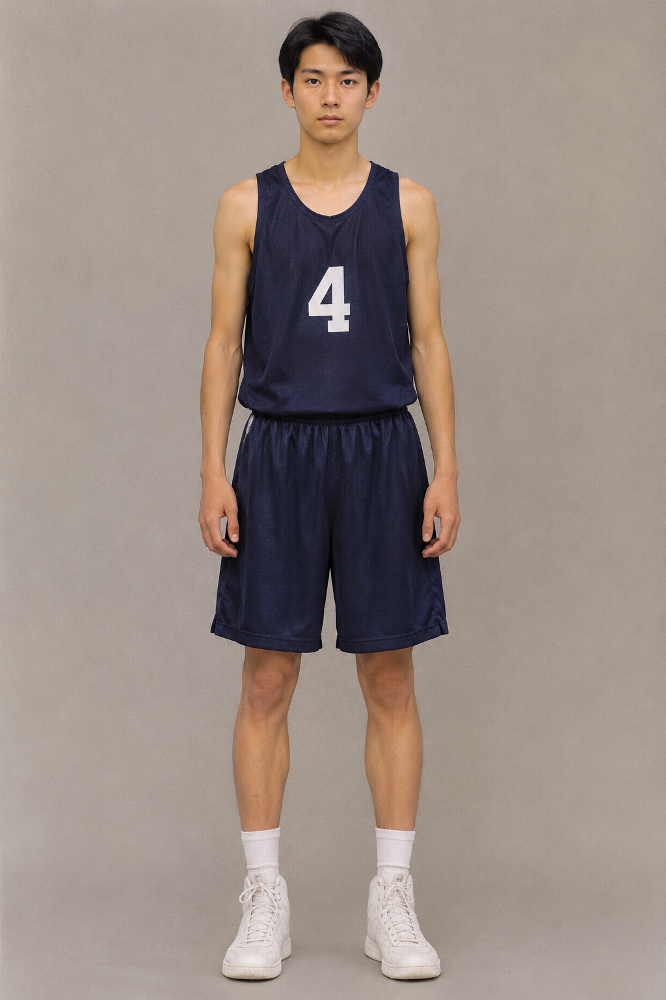

# 하마우라공고 4번

## 선수

### 창작한 주장 가드 {#identity}

중간 키에 마른 체격. 흰 4가 달린 짙은 파랑 연습복을 입는다. 공을 받기 전에 뒤를 한 번 보는 버릇이 있다. 몸을 곧게 세워 멀리 내다보고, 자기보다 낮게 들어오는 가드를 따라갈 때 첫발이 늦다. 하마우라와 선수는 이 연습경기를 위해 창작했다. [경기 의뢰](../../../instructions/commission.md#game)

## Casting reference

Generated on 2026-11-19 for the pure video diffusion comparison. The comparison is authorized to use this portrait for identity. Permanent canon approval is pending.

[Open original PNG](../../../../media/diffusion/images/cast/hamaura-04/casting-front.png) · [Generation prompt](../../../prompts/casting/hamaura-04.md)
