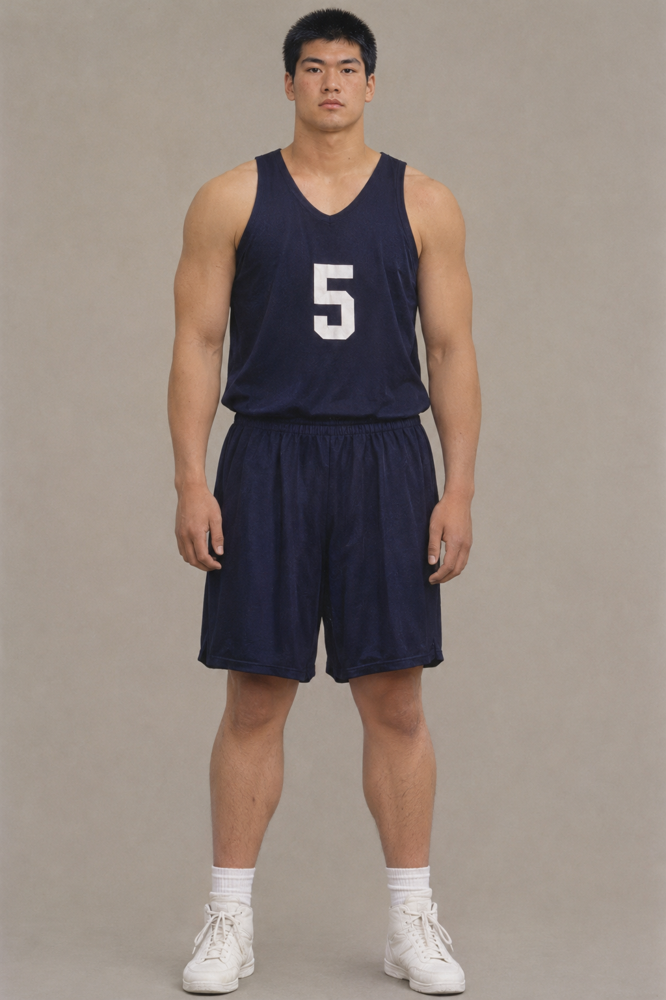

# 하마우라공고 5번

## 선수

### 창작한 센터 {#identity}

목이 굵고 어깨가 넓은 팀 최장신. 흰 5가 달린 짙은 파랑 연습복을 입는다. 앞에서 파고드는 상대를 양팔 너비로 받아 낸다. 몸통을 크게 돌려야 등 뒤를 볼 수 있다. [경기 의뢰](../../../instructions/commission.md#game)

## Casting reference

Generated on 2026-11-19 for the pure video diffusion comparison. The comparison is authorized to use this portrait for identity. Permanent canon approval is pending.

[Open original PNG](../../../../media/diffusion/images/cast/hamaura-05/casting-front.png) · [Generation prompt](../../../prompts/casting/hamaura-05.md)
