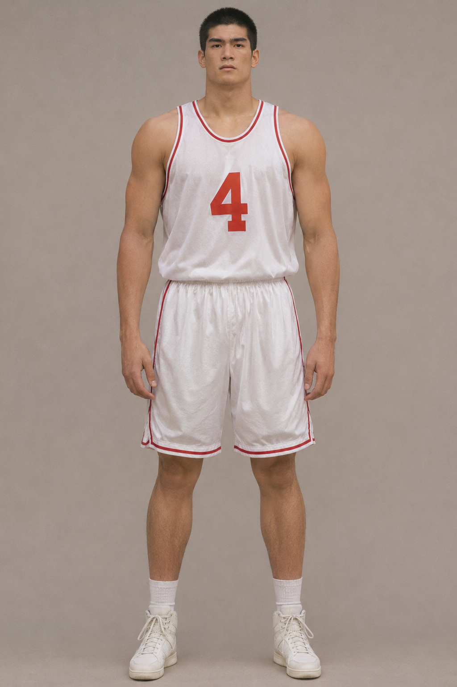

# 채치수 · 북산 4번

## 선수

### 인상과 기량 {#identity}

197cm의 3학년 센터이며 주장이다. 넓은 등으로 자기 자리를 지키고 두 손으로 높은 공을 받는다. 이 작품의 흰 연습복에는 붉은 4가 달려 있다. 동료를 부를 때 목소리를 낮고 짧게 쓴다. [북산 조사](../../../research/canon/shohoku.md)

## Casting reference

Generated on 2026-11-19 for the pure video diffusion comparison. The comparison is authorized to use this portrait for identity. Permanent canon approval is pending.

[Open original PNG](../../../../media/diffusion/images/cast/shohoku-04/casting-front.png) · [Generation prompt](../../../prompts/casting/shohoku-04.md)
