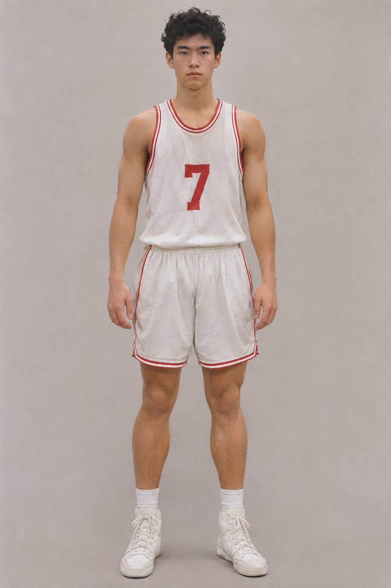

# 송태섭 · 북산 7번

## 선수

### 인상과 기량 {#identity}

168cm의 2학년 포인트가드. 단단한 하체로 낮게 방향을 틀며, 큰 수비수 앞으로 들어갈 때도 동료를 찾을 수 있다. 이 작품에서는 짧게 말아 올린 머리와 붉은 7이 달린 흰색 연습복으로 식별한다. [북산 조사](../../../research/canon/shohoku.md)

## Casting reference

Generated on 2026-11-19 for the pure video diffusion comparison. The comparison is authorized to use this portrait for identity. Permanent canon approval is pending.

[Open original PNG](../../../../media/diffusion/images/cast/shohoku-07/casting-front.png) · [Generation prompt](../../../prompts/casting/shohoku-07.md)
