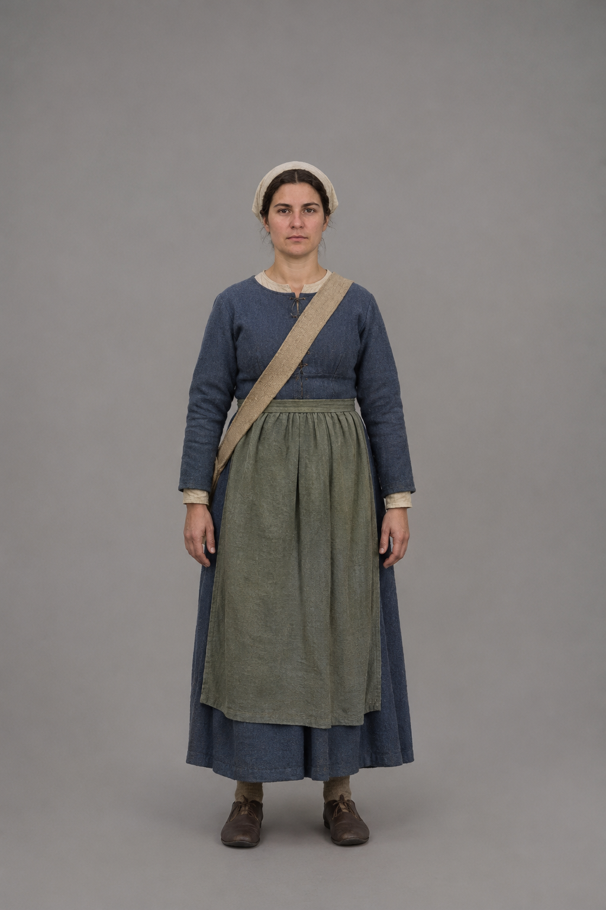
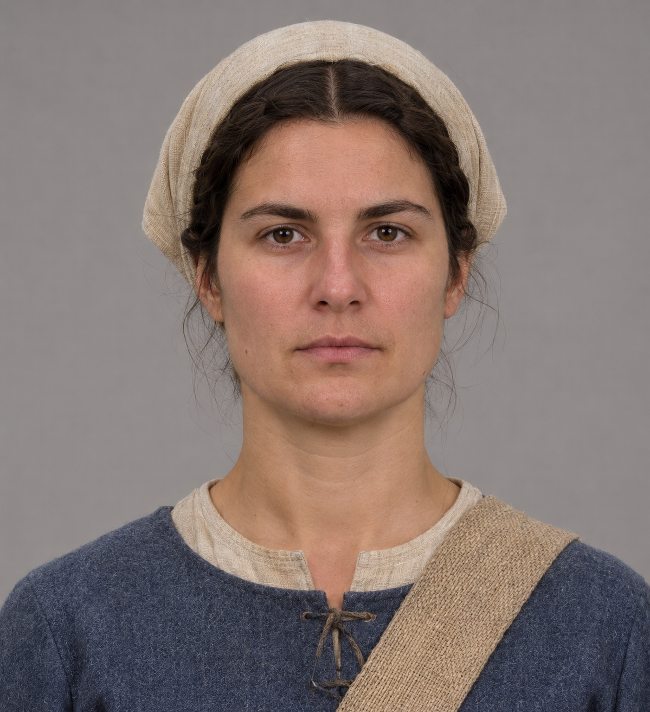

# Alix

`full.png` — Received. Visually checked against this record. A wide pale strap crosses the blue gown above a green-grey apron. Selected for the user by the commissioning viewer.

`face.png` — Received. Visually checked against this record. Dark hair parts under the pale kerchief beside the visible strap. Selected for the user by the commissioning viewer.

## Appearance

### Casting description {#appearance}

33, compact, strong bread carrier; dark braid wrapped in undyed linen kerchief, faded blue wool gown, greenish apron, broad unbleached rye-sack strap.

## Screen continuity

### In this film {#screen}

The bread carrier’s broad unbleached strap is attached to the sack. It lies across the blue of her gown while she carries it. Her kerchief covers the wrapped braid, and her greenish apron distinguishes her from either woman waiting above.

### Reference directory {#references}

`media/diffusion/images/cast/alix/`
