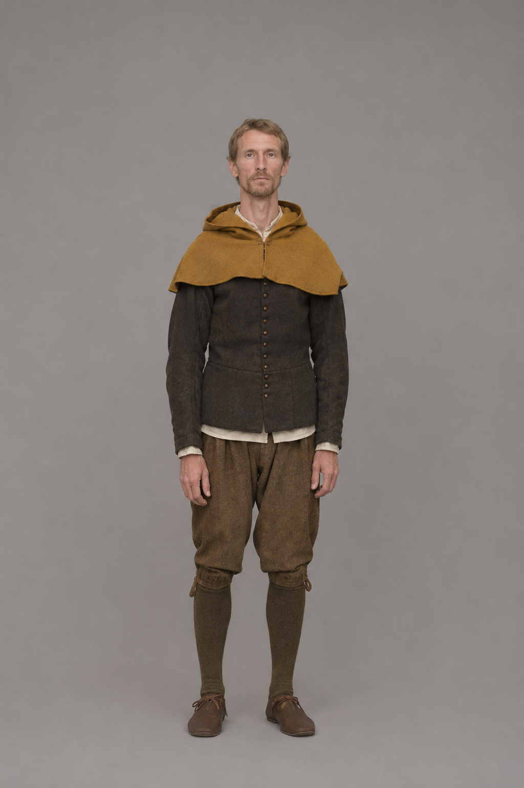
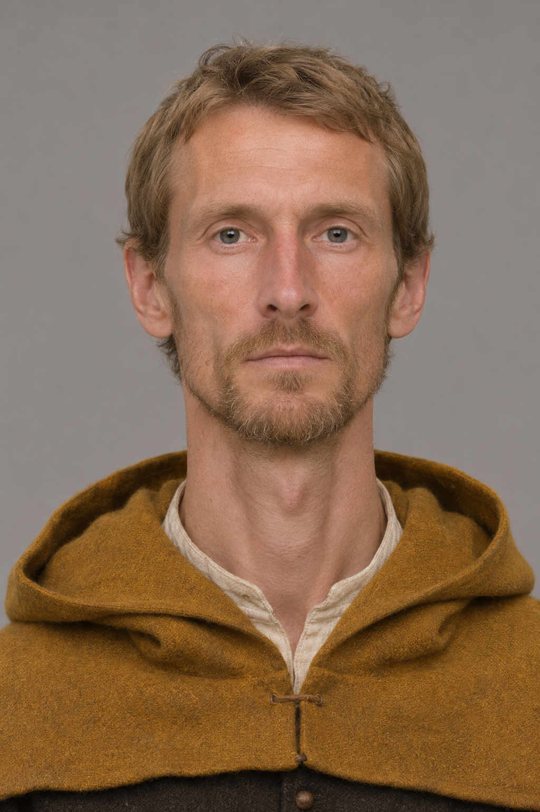

# The caller

`full.png` — Received. Visually checked against this record. The ochre hood rests back on the shoulders above a dark buttoned doublet. Selected for the user by the commissioning viewer.

`face.png` — Received. Visually checked against this record. The sandy-haired face has a sparse beard and a long neck. Selected for the user by the commissioning viewer.

## Appearance

### Casting description {#appearance}

44, narrow and long-necked, cropped sandy hair and sparse beard; yellow-brown wool hood pushed back, dark doublet.

## Screen continuity

### In this film {#screen}

The narrow man with the yellow-brown hood is the robber who speaks for the three. The hood lies back from his face. At the lower bank his sword is in its sheath, leaving both hands available for the torn end of the sack.

### Reference directory {#references}

`media/diffusion/images/cast/caller/`
