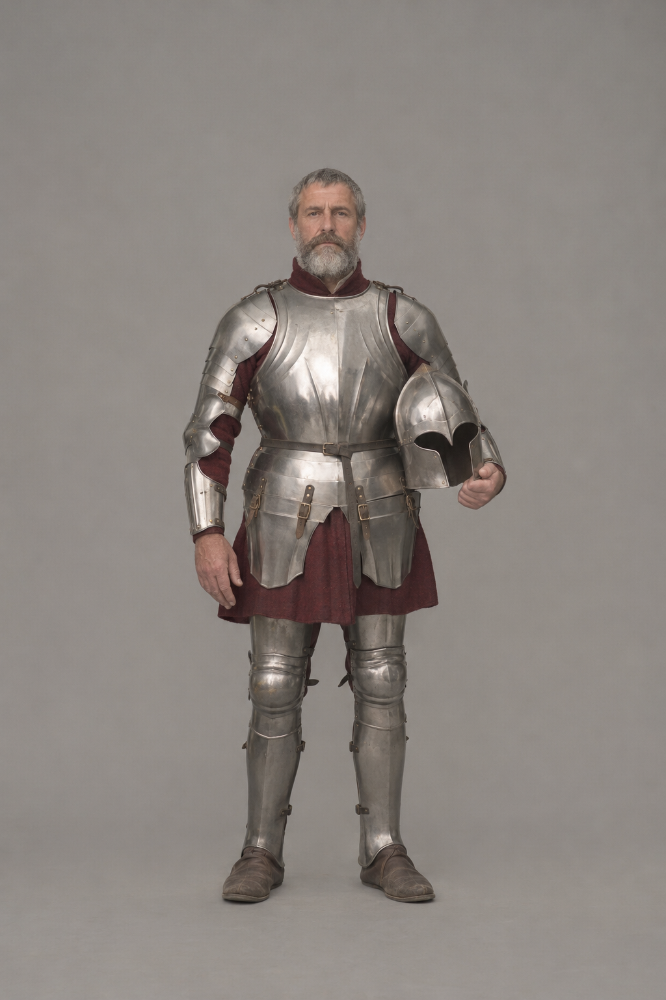
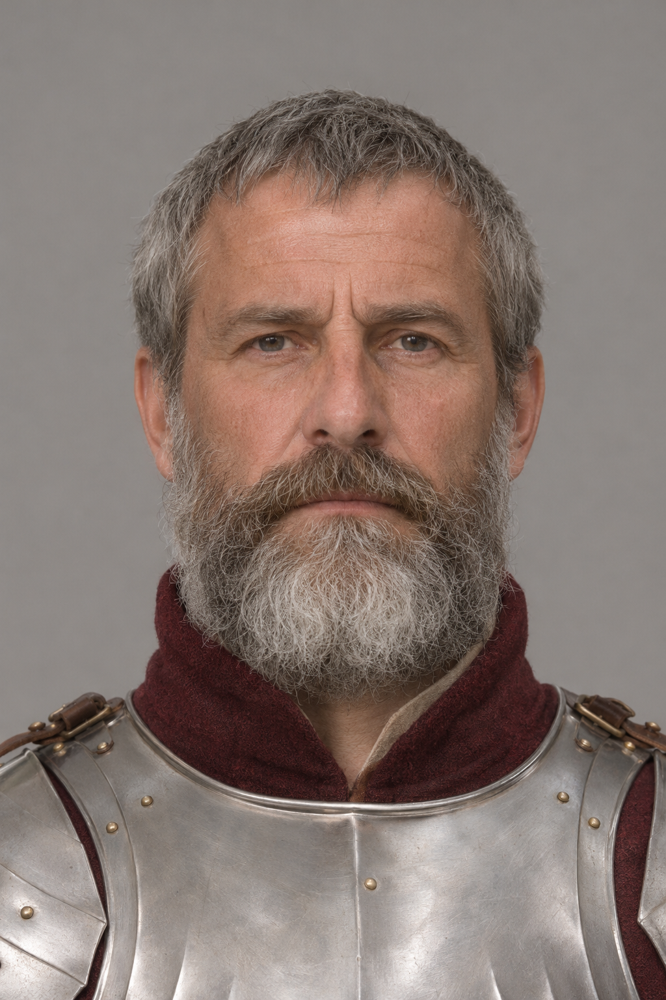

# Carlo

`full.png` — Received. Visually checked against this record. Carlo holds the helmet beside his bright plate and oxblood coat. Selected for the user by the commissioning viewer.

`face.png` — Received. Visually checked against this record. Cropped iron-grey hair and a thick beard show above the red collar. Selected for the user by the commissioning viewer.

## Appearance

### Casting description {#appearance}

55, broad knight with cropped iron-grey hair and a thick grey beard. A polished Milanese barbute has a T-shaped face opening. Oxblood wool shows beneath his bright plate.

## Screen continuity

### In this film {#screen}

The grey-bearded visitor from Milan wears the bright helmet in the yard. His beard shows in its face opening. The sound saddle beside Martin’s belongs to him when the men give their word. The helmet’s period comparison is the polished Milanese example in the [historical study](../../../research/history/road-and-households.md#riders).

### Reference directory {#references}

`media/diffusion/images/cast/carlo/`
