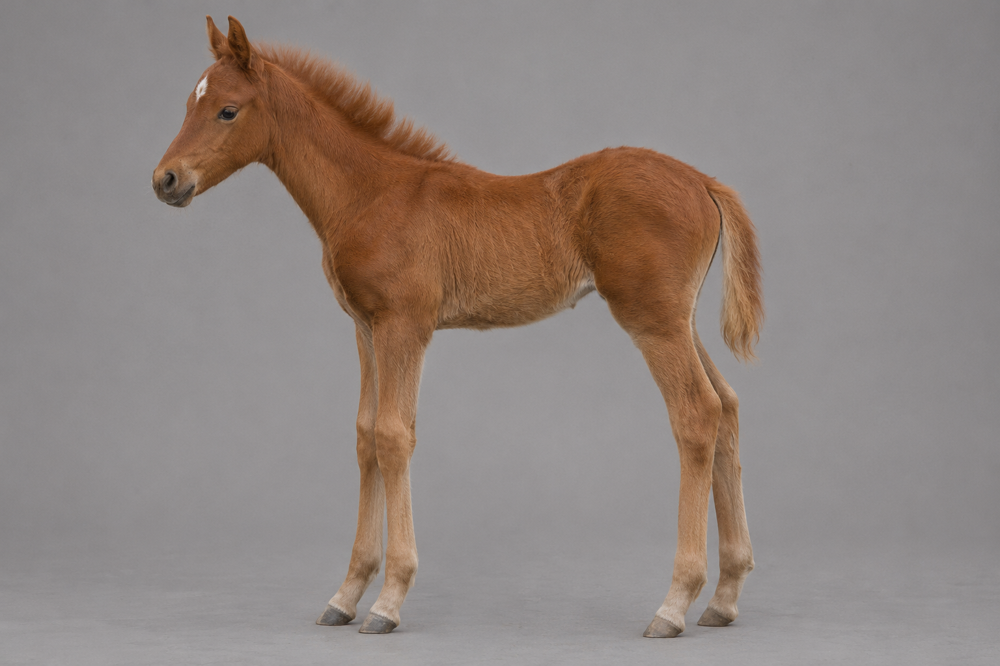
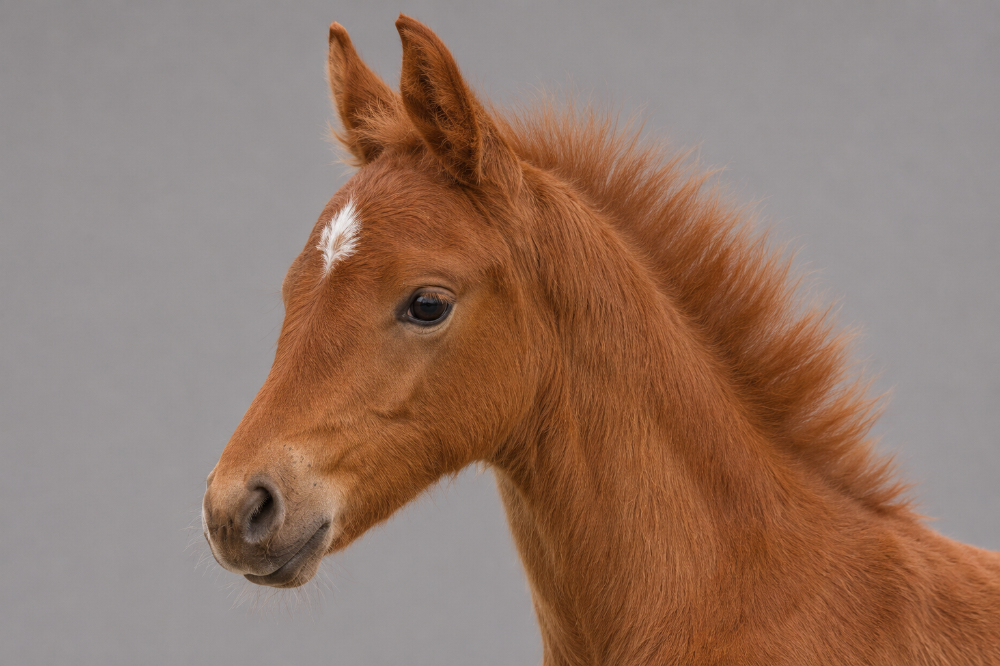

# Chestnut foal

`full.png` — Received. Visually checked against this record. The untacked chestnut stands on long, slightly lighter legs. Selected for the user by the commissioning viewer.

`face.png` — Received. Visually checked against this record. A small white star sits below the short upright mane. Selected for the user by the commissioning viewer.

## Appearance

### Casting description {#appearance}

3-month-old long-legged light chestnut foal, fuzzy upright mane and small white forehead star. Untacked.

## Screen continuity

### In this film {#screen}

The young chestnut inside the paddock is long-legged beside its compact mother. Its upright fuzzy mane and small white forehead star identify it through the gate rails. It wears no tack.

### Reference directory {#references}

`media/diffusion/images/cast/chestnut-foal/`
