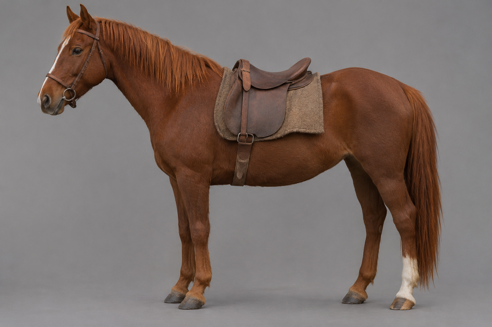
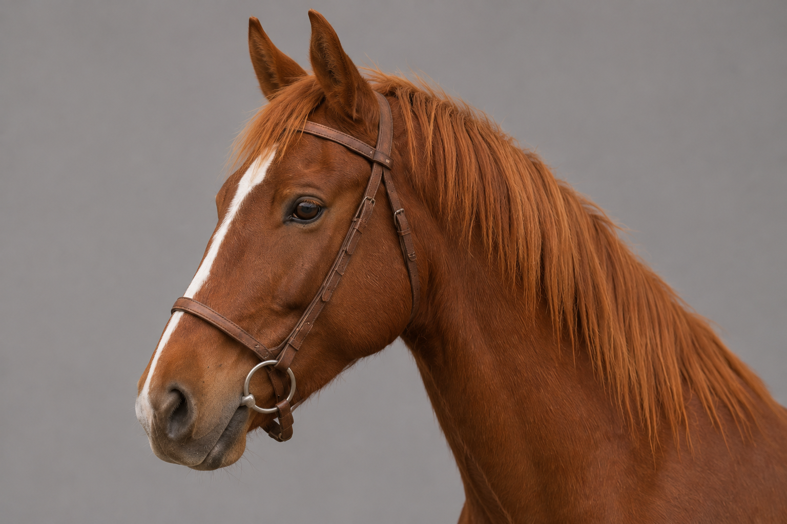

# Chestnut mare

`full.png` — Received. Visually checked against this record. The chestnut stands in brown tack with one white hind sock. Selected for the user by the commissioning viewer.

`face.png` — Received. Visually checked against this record. A narrow blaze runs past the brown bridle beneath the copper forelock. Selected for the user by the commissioning viewer.

## Appearance

### Casting description {#appearance}

8-year-old compact chestnut mare, copper mane and tail, white LEFT HIND sock; plain brown bridle and saddle.

## Screen continuity

### In this film {#screen}

The compact chestnut is the foal’s mother. The white sock is on the left hind leg. Her plain brown bridle, reins and saddle remain on her in both ridden and riderless views. The little star belongs to her foal.

### Reference directory {#references}

`media/diffusion/images/cast/chestnut-mare/`
