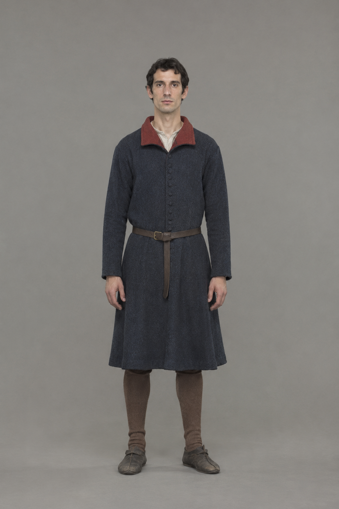
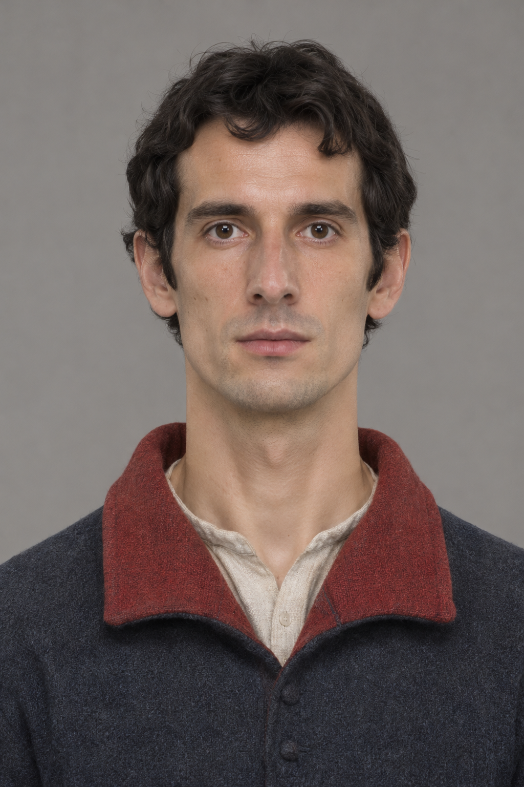

# Colin

`full.png` — Received. Visually checked against this record. A faded red collar marks the long charcoal-blue coat. Selected for the user by the commissioning viewer.

`face.png` — Received. Visually checked against this record. The clean-shaven, narrow face sits above the red collar. Selected for the user by the commissioning viewer.

## Appearance

### Casting description {#appearance}

29, lean and long-faced, cropped black hair, clean-shaven; charcoal-blue wool coat, faded red collar.

## Screen continuity

### In this film {#screen}

The lean, clean-shaven cousin is a hired sword from the other branch of the family. Facing the gate, his place is the right rear, the pole on his left shoulder. The red at the collar of his charcoal-blue coat identifies him across the width of the bier from Denis.

### Reference directory {#references}

`media/diffusion/images/cast/colin/`
