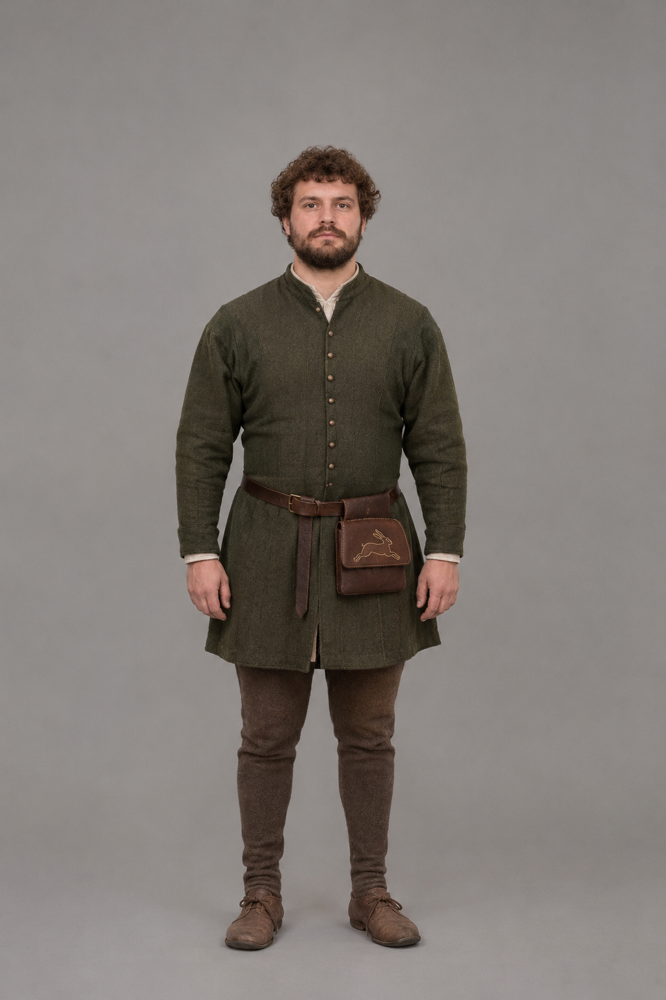
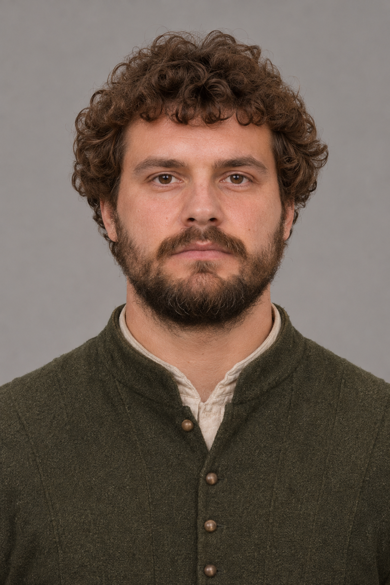

# Denis

`full.png` — Received. Visually checked against this record. A flat leather belt purse shows a stitched hare against his green doublet. Selected for the user by the commissioning viewer.

`face.png` — Received. Visually checked against this record. Dense brown curls and a trimmed beard frame the face. Selected for the user by the commissioning viewer.

## Appearance

### Casting description {#appearance}

32, stocky, dense short brown curls and trimmed brown beard; muted dark green wool doublet, brown belt with crooked-eared hare purse.

## Screen continuity

### In this film {#screen}

The stockier cousin is a hired sword and the widow’s nephew. Facing the burial gate, his place is the left rear, the pole on his right shoulder. The purse at his belt has a hare stitched on its flap with one crooked ear.

### Reference directory {#references}

`media/diffusion/images/cast/denis/`
