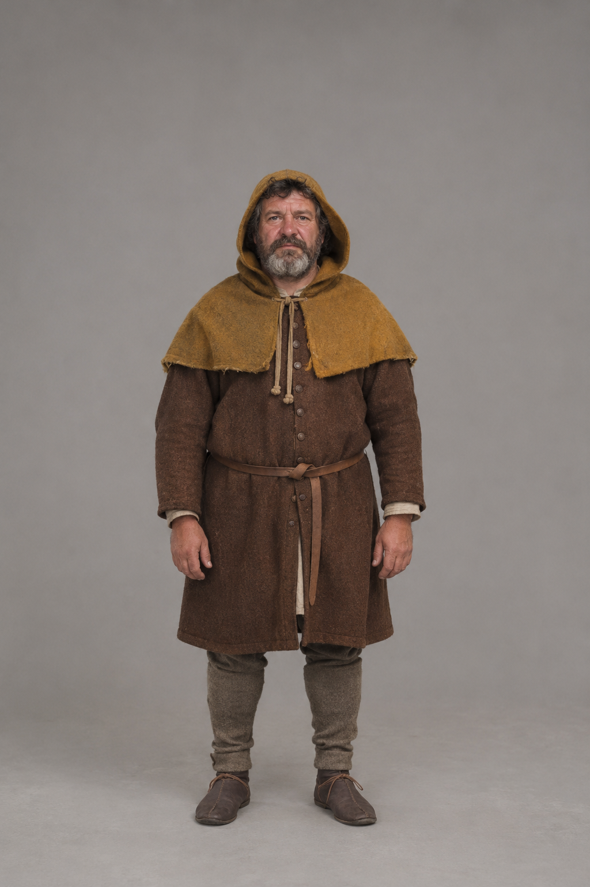
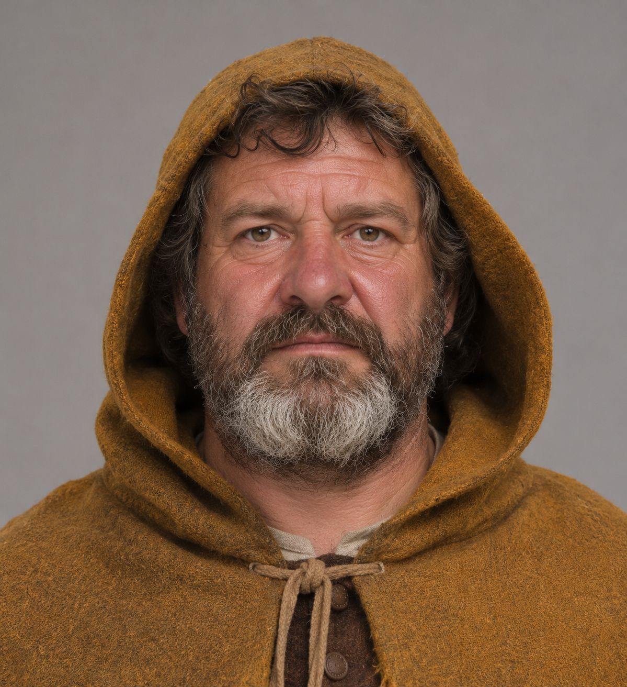

# Left front bearer

`full.png` — Received. Visually checked against this record. An ochre hood covers the head above a stocky figure in brown wool. Selected for the user by the commissioning viewer.

`face.png` — Received. Visually checked against this record. His grey-streaked beard sits inside the ochre hood. Selected for the user by the commissioning viewer.

## Appearance

### Casting description {#appearance}

50, short, broad square build, pepper-grey beard; weathered ochre wool hood and brown coat.

## Screen continuity

### In this film {#screen}

The short, broad bearer in the ochre hood carries the left front throughout, facing the burial gate. His beard is pepper-grey. The left rear corner, first Denis’s, travels behind him.

### Reference directory {#references}

`media/diffusion/images/cast/front-bearer-left/`
