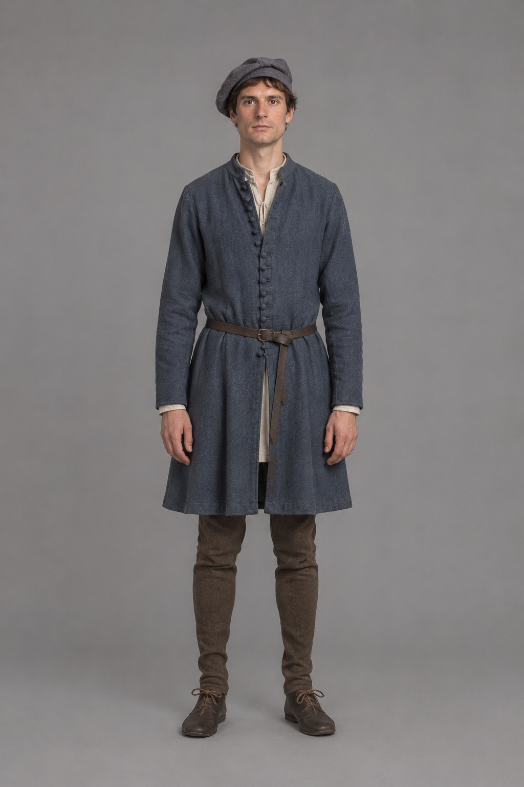
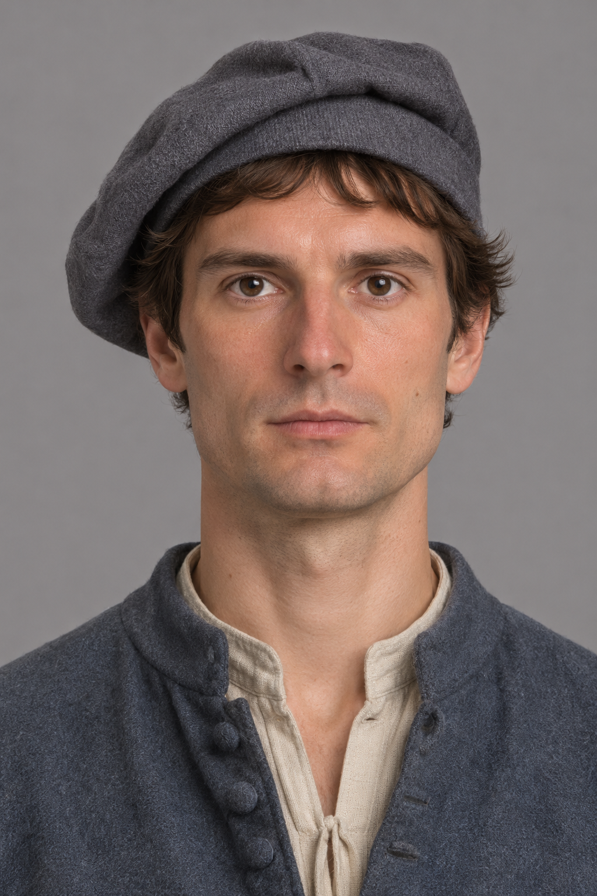

# Right front bearer

`full.png` — Received. Visually checked against this record. The soft slate cap and blue-grey coat mark the taller bearer. Selected for the user by the commissioning viewer.

`face.png` — Received. Visually checked against this record. Short chestnut hair is visible beneath the cap on the clean-shaven face. Selected for the user by the commissioning viewer.

## Appearance

### Casting description {#appearance}

31, taller, clean-shaven, short chestnut hair under soft slate cap; blue-grey coat.

## Screen continuity

### In this film {#screen}

The taller front bearer carries the right pole throughout, facing the burial gate. His soft slate cap sits above his partner’s ochre hood. The right rear corner, first Colin’s, travels behind him.

### Reference directory {#references}

`media/diffusion/images/cast/front-bearer-right/`
