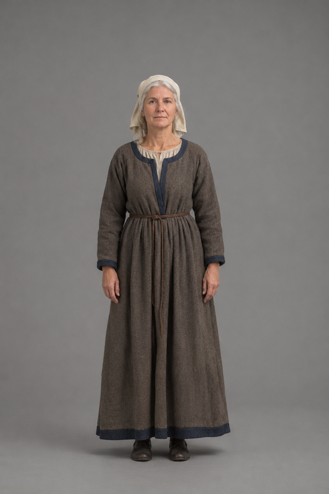
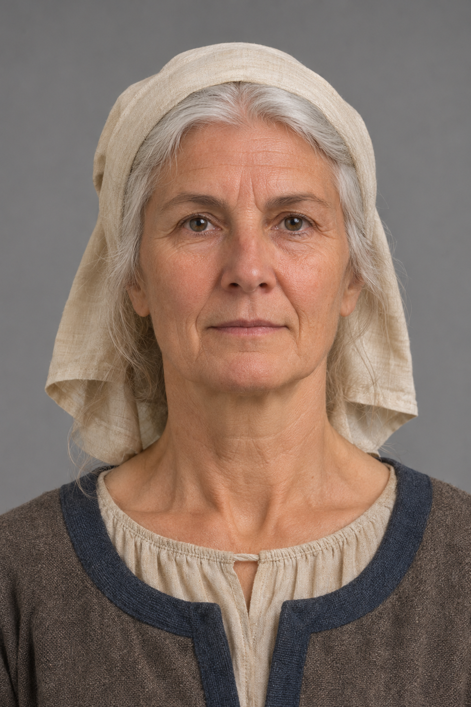

# Woman at the burial gate

`full.png` — Received. Visually checked against this record. Dark blue edging outlines the grey-brown gown beneath the cream kerchief. Selected for the user by the commissioning viewer.

`face.png` — Received. Visually checked against this record. Silver hair shows inside the cream linen at the temples. Selected for the user by the commissioning viewer.

## Appearance

### Casting description {#appearance}

60, lean, with silver hair under a cream linen kerchief. Her grey-brown gown has dark blue edging.

## Screen continuity

### In this film {#screen}

The woman stationed at the burial gate has a cream kerchief and dark blue edging on her gown. Her place beside the gatepost distinguishes her from the mourners walking along the lane. The voice giving the petition from the gate belongs to her.

### Reference directory {#references}

`media/diffusion/images/cast/gate-woman/`
