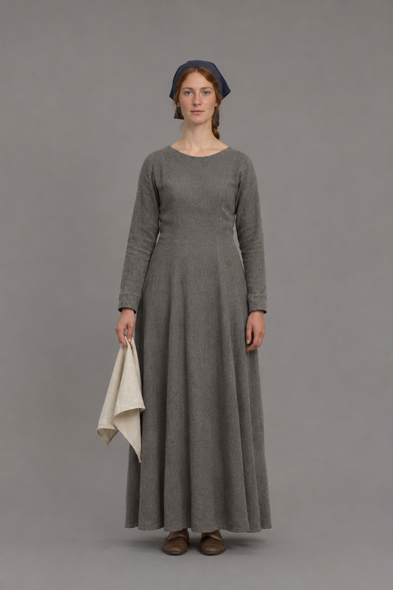
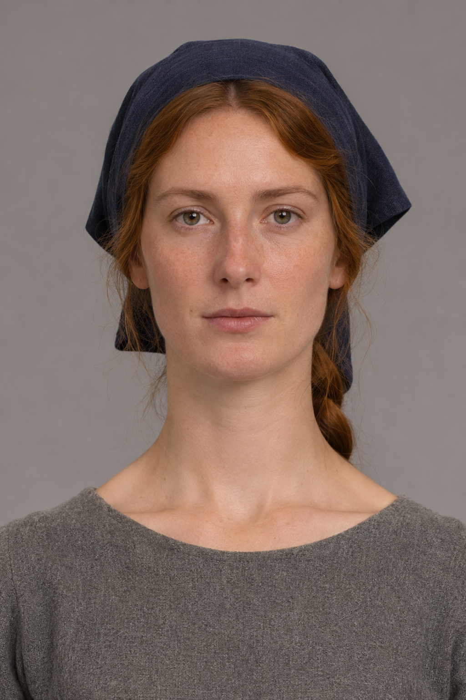

# Her companion at the stump

`full.png` — Received. Visually checked against this record. A separate plain bread cloth hangs from one hand beside her grey gown. Selected for the user by the commissioning viewer.

`face.png` — Received. Visually checked against this record. Auburn hair shows beneath the dark blue kerchief. Selected for the user by the commissioning viewer.

## Appearance

### Casting description {#appearance}

29, taller, auburn braid at nape under dark blue kerchief; undyed grey wool gown, plain unbleached bread cloth.

## Screen continuity

### In this film {#screen}

The taller hospice woman wears the dark blue kerchief. Her bread cloth is plain unbleached linen throughout. Its long plain end belongs with her grey gown even when someone else carries the bread in it.

### Reference directory {#references}

`media/diffusion/images/cast/hospice-companion/`
