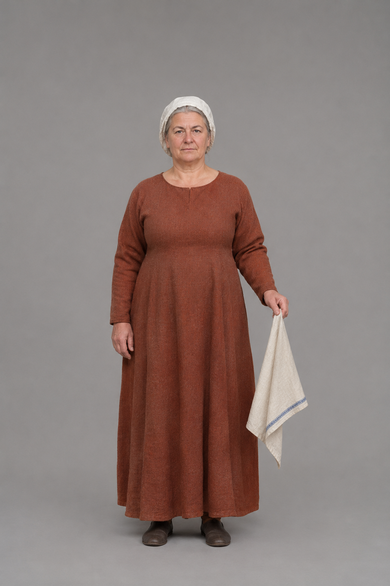
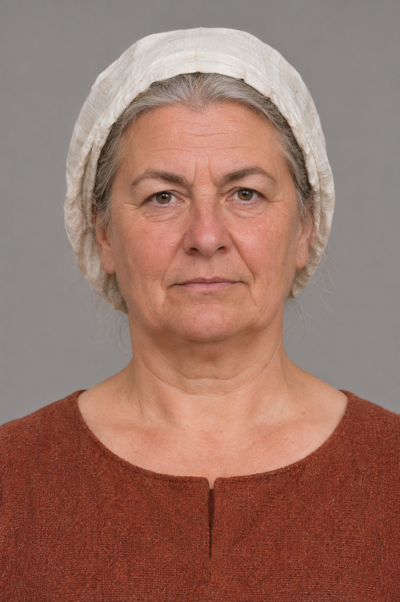

# Hospice woman who calls

`full.png` — Received. Visually checked against this record. She holds a separate pale cloth with a narrow blue edge beside her russet gown. Selected for the user by the commissioning viewer.

`face.png` — Received. Visually checked against this record. Grey hair shows beneath a white coif. Selected for the user by the commissioning viewer.

## Appearance

### Casting description {#appearance}

53, solid frame, grey hair under plain white linen coif; russet wool gown, unbleached bread cloth with narrow blue woven edge.

## Screen continuity

### In this film {#screen}

The older hospice woman owns the blue-edged cloth. She can be picked out above the stump by her white coif and russet gown. The long blue edge still identifies her cloth when it is folded around bread.

### Reference directory {#references}

`media/diffusion/images/cast/hospice-speaker/`
