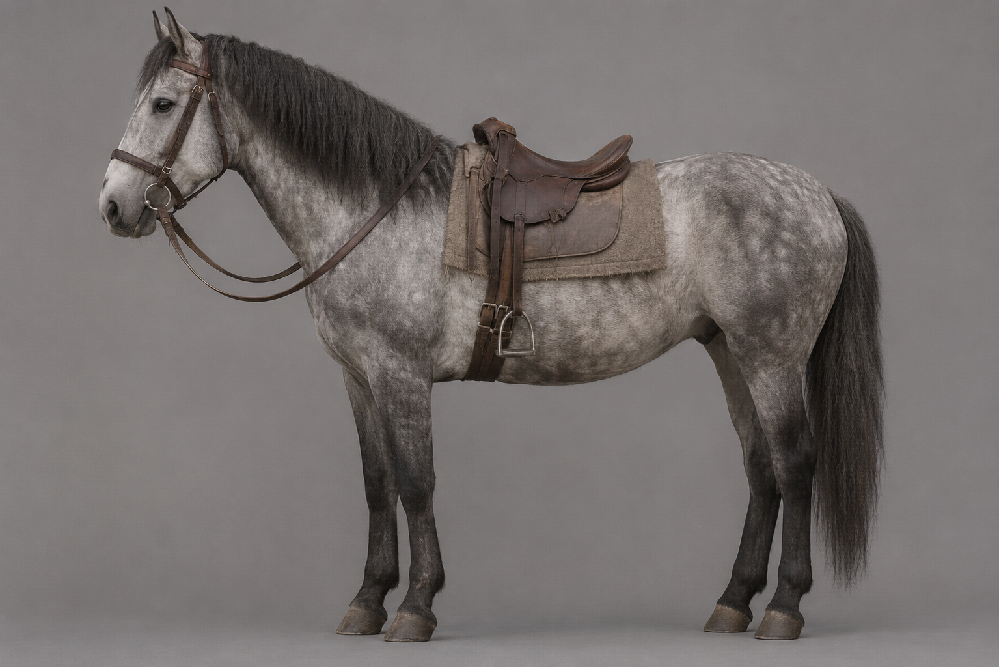
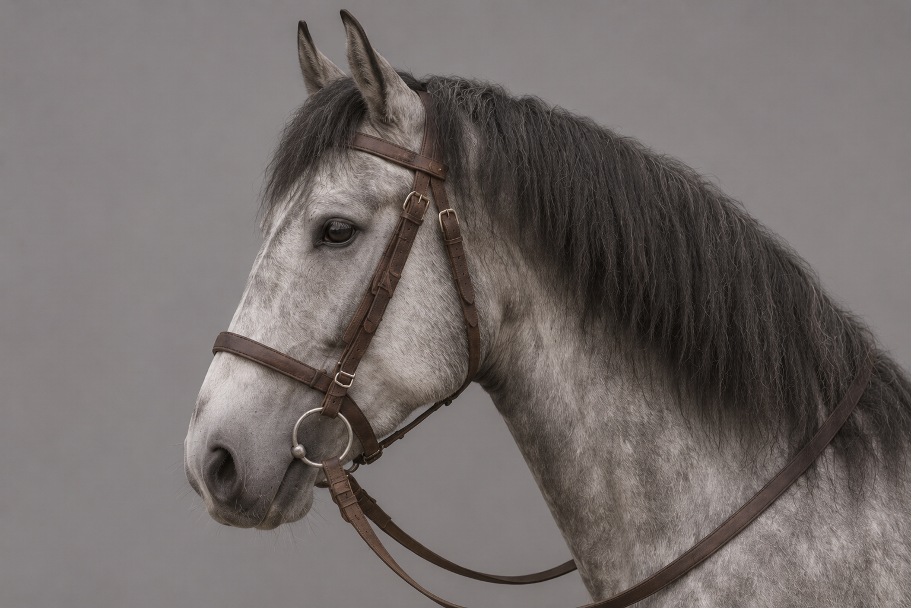

# Luc's grey

`full.png` — Received. Visually checked against this record. Dark legs and a charcoal tail set off the dappled grey body and dark saddle. Selected for the user by the commissioning viewer.

`face.png` — Received. Visually checked against this record. The dark mane falls behind a grey face in a plain bridle. Selected for the user by the commissioning viewer.

## Appearance

### Casting description {#appearance}

10-year-old larger dapple-grey gelding, charcoal mane and tail, dark legs, plain dark brown riding tack.

## Screen continuity

### In this film {#screen}

Luc’s mount is the larger dapple-grey gelding, dark-legged and charcoal-maned. He is physically behind the chestnut when he begins to slow, before the mare slows. His dark brown saddle has the loop for Luc’s striped mace. At rest outside the paddock there is slack in his rein.

### Reference directory {#references}

`media/diffusion/images/cast/luc-grey/`
