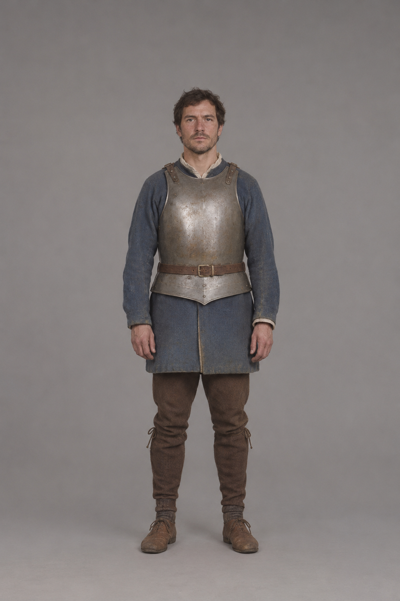
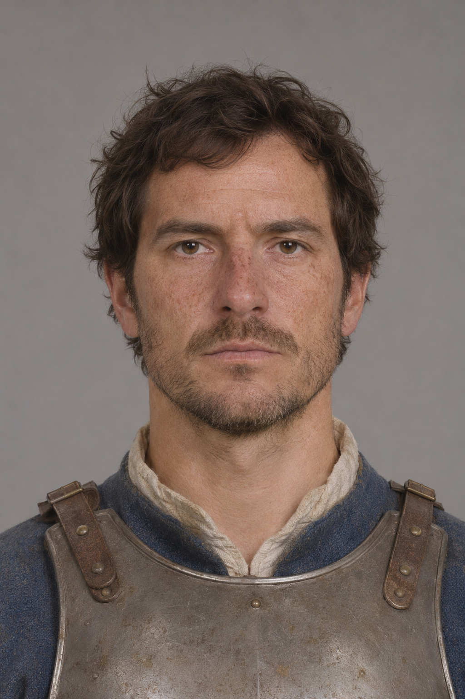

# Luc

`full.png` — Received. Visually checked against this record. His brown belt crosses a dull breastplate over faded blue sleeves. Selected for the user by the commissioning viewer.

`face.png` — Received. Visually checked against this record. Short dark hair and stubble frame a broad, freckled nose. Selected for the user by the commissioning viewer.

## Appearance

### Casting description {#appearance}

36, compact, broad freckled nose, short dark brown hair and light stubble; dull steel breastplate over faded blue wool coat, brown belt.

## Screen continuity

### In this film {#screen}

Luc is the chestnut mare’s keeper and the rider of the larger dapple-grey. His freckled nose, faded blue coat and dull breastplate distinguish him from Rémy. At the gate he stands outside with the grey’s reins in his left hand. His issued mace fits the loop on the grey’s saddle.

### Reference directory {#references}

`media/diffusion/images/cast/luc/`
