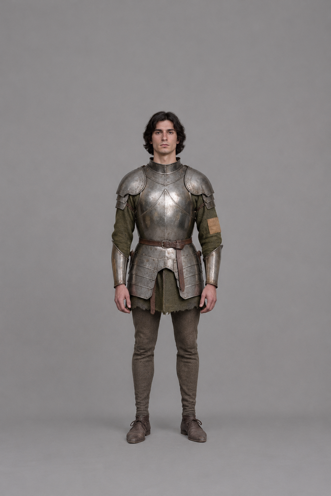
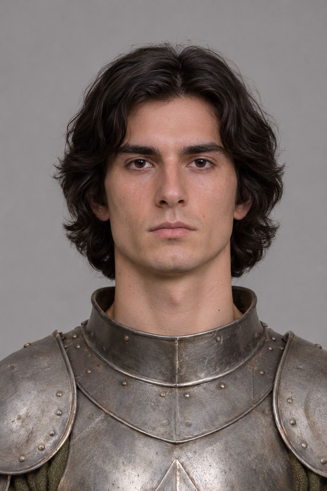

# Martin

`full.png` — Received. Visually checked against this record. Green sleeves show under the dull plates, with the tan patch on his left arm. Selected for the user by the commissioning viewer.

`face.png` — Received. Visually checked against this record. Dark, jaw-length hair frames a clean-shaven face above the steel collar. Selected for the user by the commissioning viewer.

## Appearance

### Casting description {#appearance}

25, tall lean knight, dark straight jaw-length hair, clean-shaven; dull steel armour over moss-green wool sleeves, tan left elbow patch.

## Screen continuity

### In this film {#screen}

The younger of the two knights belongs to this household. His moss-green sleeves and patched left elbow distinguish him in armour. The split saddle on the bench is the one he brought to the wager.

### Reference directory {#references}

`media/diffusion/images/cast/martin/`
