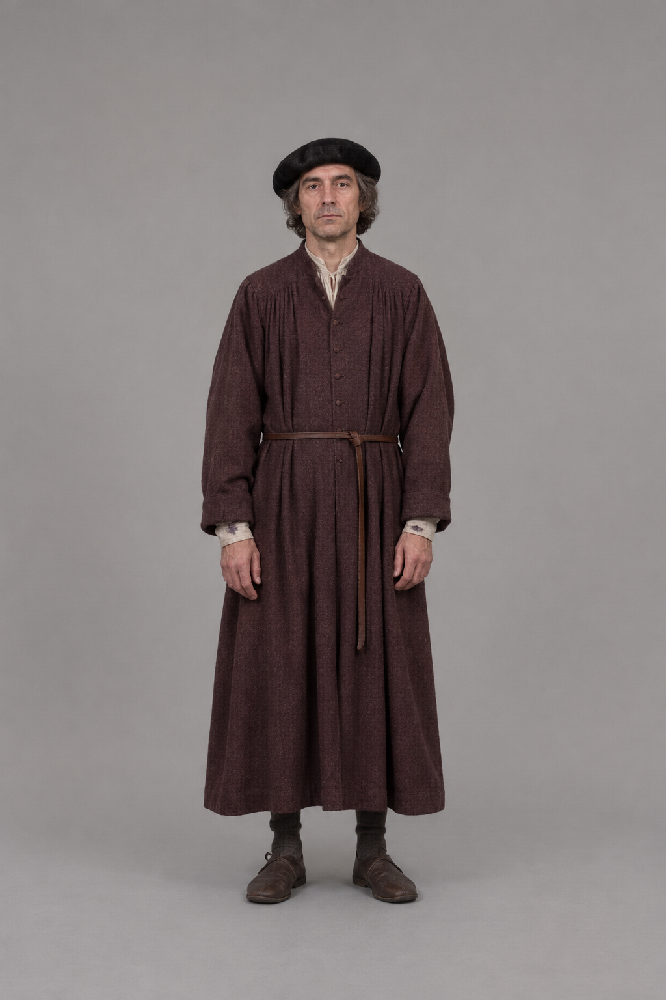
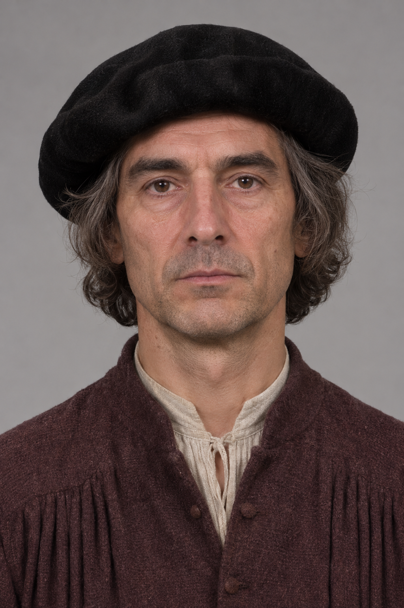

# Muster clerk

`full.png` — Received. Visually checked against this record. His long plum-brown gown is belted below a round black cap. Selected for the user by the commissioning viewer.

`face.png` — Received. Visually checked against this record. Grey-brown hair shows under the soft black crown. Selected for the user by the commissioning viewer.

## Appearance

### Casting description {#appearance}

48, narrow stooped shoulders, greying dark bob under round black cap; long plum-brown wool gown, small ink stain on right cuff.

## Screen continuity

### In this film {#screen}

The household official at the pay bench wears the round black cap and the long plum-brown gown. The ink mark is on the right cuff, visible at the height of a mounted man’s belt when the clerk pays him.

### Reference directory {#references}

`media/diffusion/images/cast/muster-clerk/`
