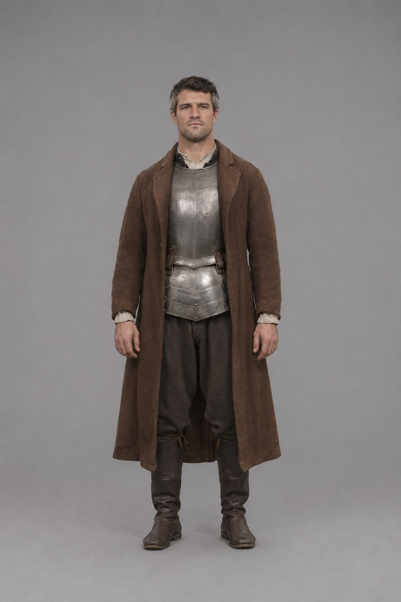
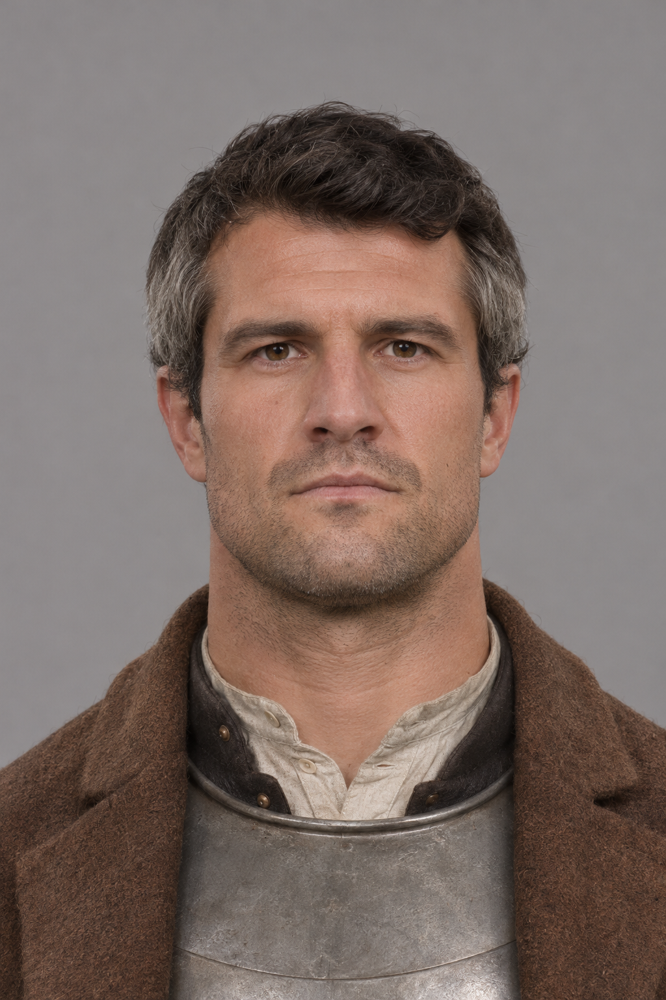

# Perrin

`full.png` — Received. Visually checked against this record. The long brown coat hangs open around the breastplate and dark boots. Selected for the user by the commissioning viewer.

`face.png` — Received. Visually checked against this record. The cropped dark hair lightens at both temples. Selected for the user by the commissioning viewer.

## Appearance

### Casting description {#appearance}

38, sturdy with broad shoulders, cropped dark hair and grey temples; iron-grey plate under open brown wool coat with long tails, dark leather boots.

## Screen continuity

### In this film {#screen}

The knight accompanying Alix wears his iron-grey plate beneath an open coat. Its long brown tails hang free behind his legs. His sword and its sheath belong to him. The broad strap of the bread sack belongs with Alix’s load.

### Reference directory {#references}

`media/diffusion/images/cast/perrin/`
