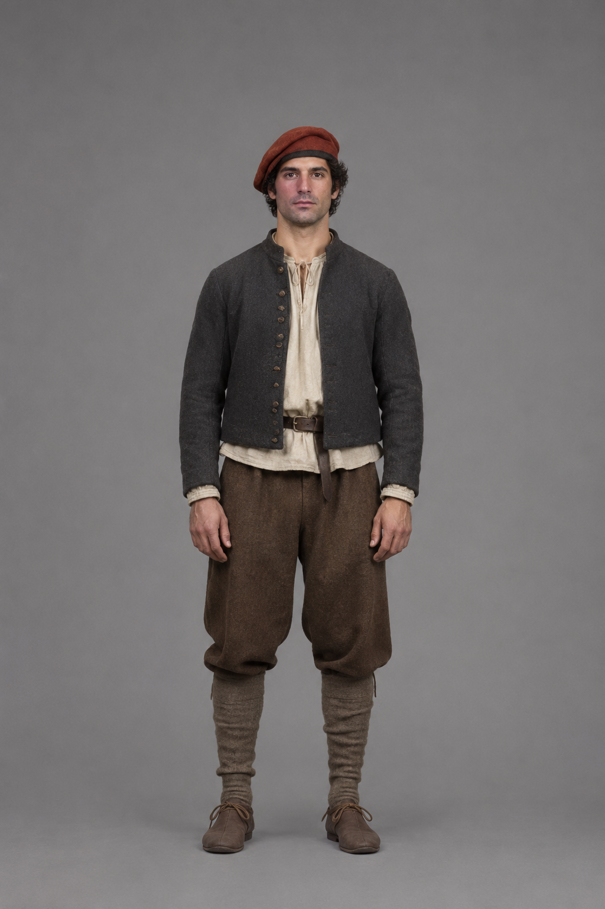
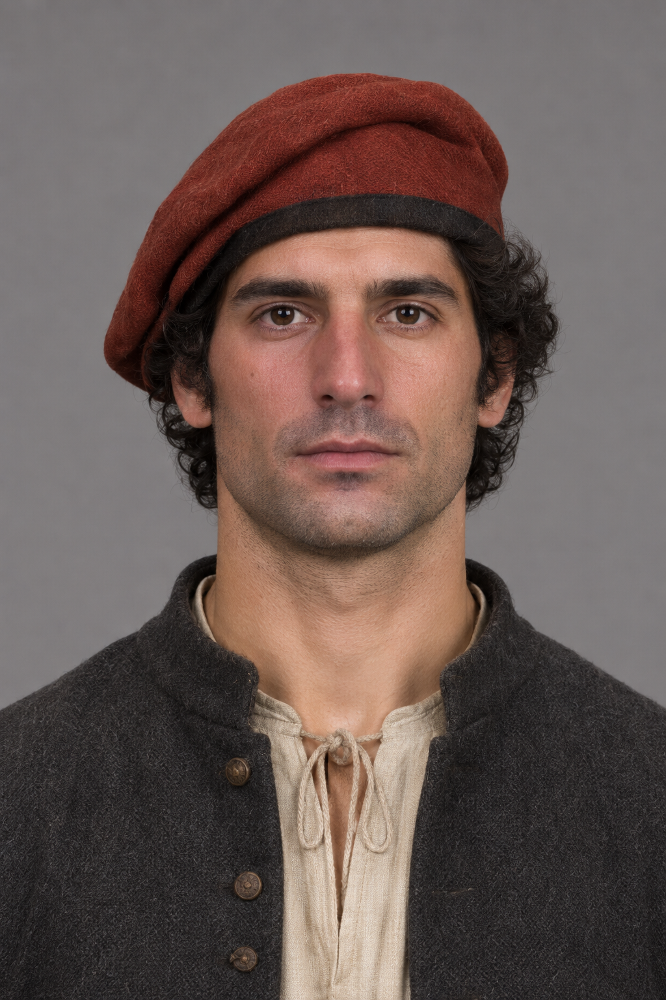

# Red Cap

`full.png` — Received. Visually checked against this record. A brick-red cap sits over a short charcoal jacket. Selected for the user by the commissioning viewer.

`face.png` — Received. Visually checked against this record. Dark curls show under the black band of the red cap. Selected for the user by the commissioning viewer.

## Appearance

### Casting description {#appearance}

30, broad-chested, short black curls beneath brick-red soft cap that comes off, cropped charcoal wool jacket.

## Screen continuity

### In this film {#screen}

The broad-chested robber has two recognizable appearances, brick-red cap on black curls and the same uncovered head above the cropped charcoal jacket. The cap stays on the split rock after it comes off. His sword is on the lower path at the bank while he bears the belly of the sack.

### Reference directory {#references}

`media/diffusion/images/cast/red-cap/`
