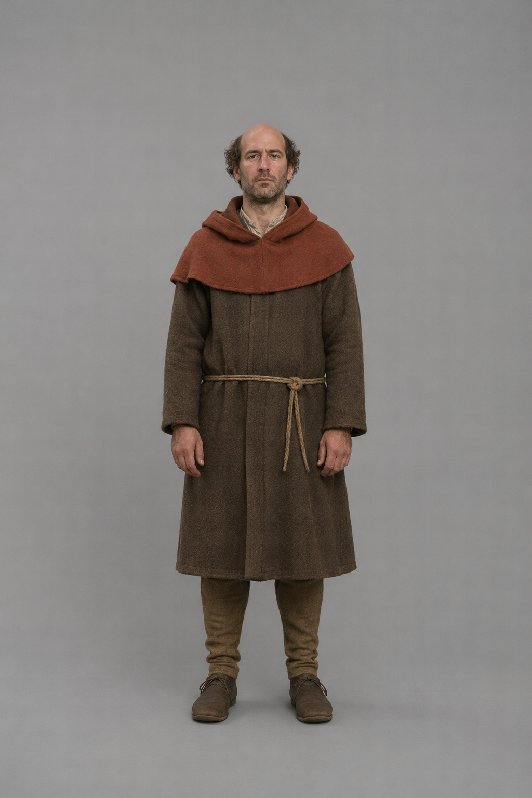
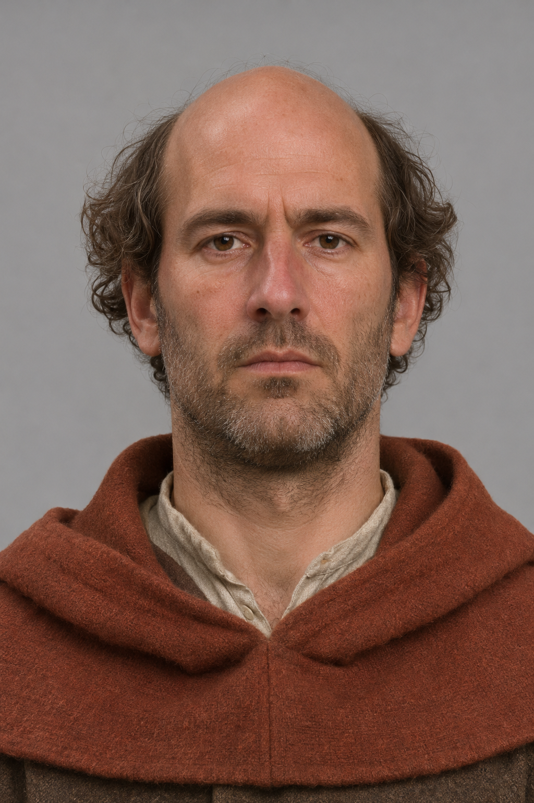

# Relief bearer

`full.png` — Received. Visually checked against this record. The russet hood rests over a coarse umber coat tied with rope. Selected for the user by the commissioning viewer.

`face.png` — Received. Visually checked against this record. Dark hair at the ears leaves his crown bare. Selected for the user by the commissioning viewer.

## Appearance

### Casting description {#appearance}

45, tall labourer, bald crown with dark hair at sides; russet hood and coarse umber wool coat.

## Screen continuity

### In this film {#screen}

The mourner beside Colin is a tall labourer with a bald crown and a russet hood. His carrying place is the right rear, on the left shoulder, directly behind the bearer in the slate cap.

### Reference directory {#references}

`media/diffusion/images/cast/relief-bearer/`
