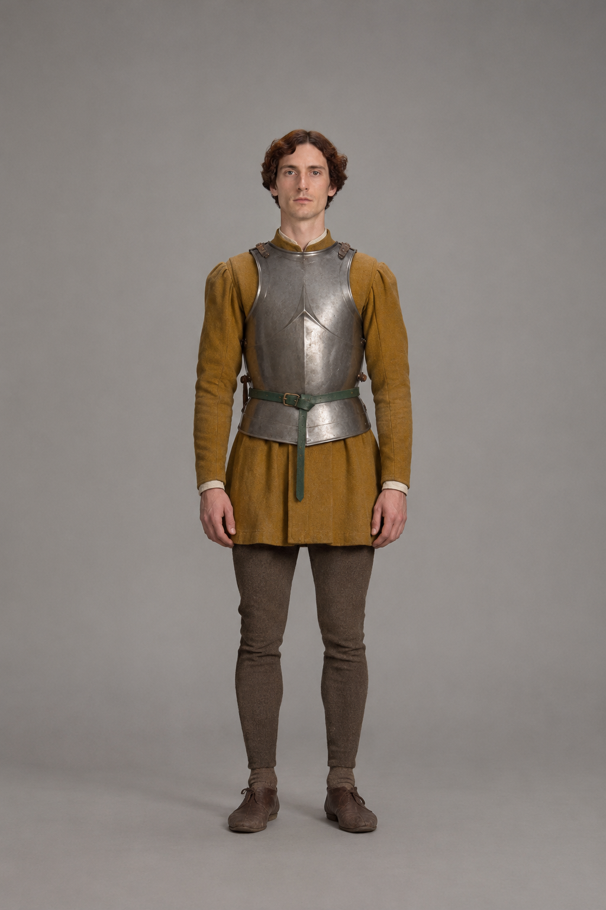
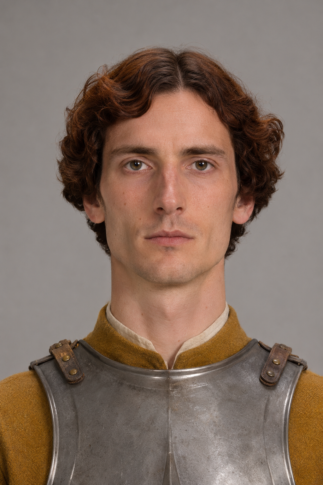

# Rémy

`full.png` — Received. Visually checked against this record. An ochre coat shows under the plate and the thin green belt. Selected for the user by the commissioning viewer.

`face.png` — Received. Visually checked against this record. Auburn hair curls at the ears above the ochre collar. Selected for the user by the commissioning viewer.

## Appearance

### Casting description {#appearance}

28, tall and narrow, dark auburn hair cut to ears, clean-shaven; grey steel breastplate over ochre wool, narrow green belt.

## Screen continuity

### In this film {#screen}

Rémy claims a rider’s wage on the chestnut mare he stole. His purse hangs from the narrow green belt over his ochre wool. The wage goes with that belt. The mare’s brown saddle and its empty mace loop stay on the horse.

### Reference directory {#references}

`media/diffusion/images/cast/remy/`
