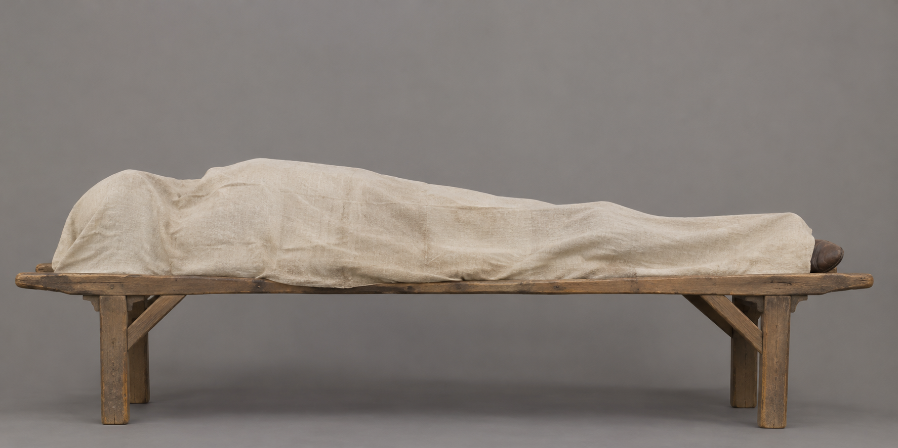
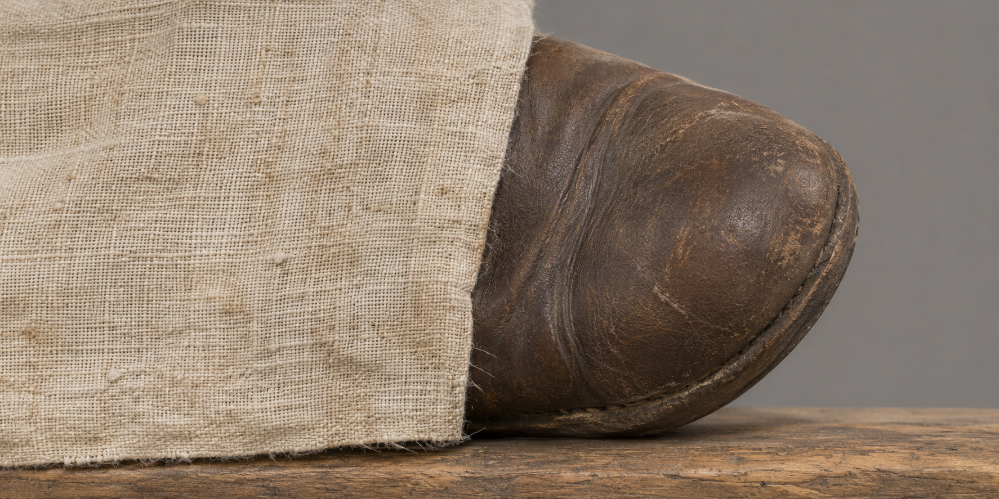

# The shrouded uncle

`full.png` — Received. Visually checked against this record. The off-white linen follows the length of the bier and leaves a small brown toe showing at one end. Selected for the user by the commissioning viewer.

`shoe.png` — Received. Visually checked against this record. A worn leather shoe toe projects from beneath the linen hem. Selected for the user by the commissioning viewer.

## Appearance

### Casting description {#appearance}

Off-white linen covers the full length of the figure on the bier. The drape makes a low ridge over one foot at the widow's corner. As the hem shifts, the worn toe of a dark brown leather shoe shows beneath it.

## Screen continuity

### In this film {#screen}

Off-white linen covers the figure on the bier. The feet are at the rear. At the left rear corner a low ridge in the linen marks the place where a worn brown leather toe can show beneath the hem.

### Reference directory {#references}

`media/diffusion/images/cast/shrouded-uncle/`
