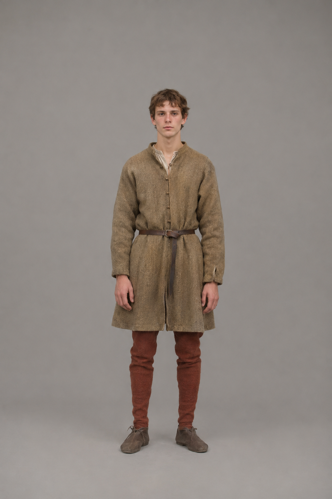
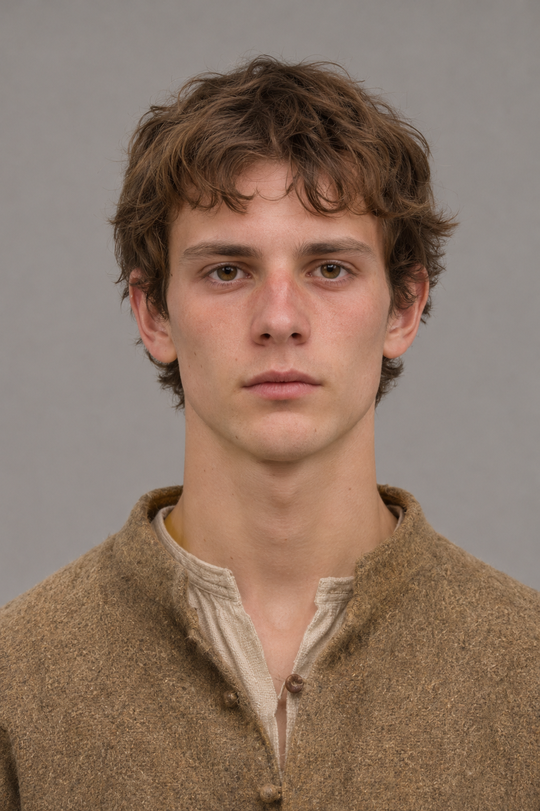

# Stable lad

`full.png` — Received. Visually checked against this record. The belted oat coat falls over rust-coloured hose. Selected for the user by the commissioning viewer.

`face.png` — Received. Visually checked against this record. Short, uneven brown hair curls above his brow. Selected for the user by the commissioning viewer.

## Appearance

### Casting description {#appearance}

18, wiry stable worker, short uneven chestnut hair; oat-coloured belted wool coat, russet hose, split seam on left wool cuff.

## Screen continuity

### In this film {#screen}

The household’s young stable worker wears his oat-coloured coat at the saddle bench. The split seam belongs to his left cuff. The larger split, in the leather seat beside him, belongs to Martin’s saddle.

### Reference directory {#references}

`media/diffusion/images/cast/stable-lad/`
