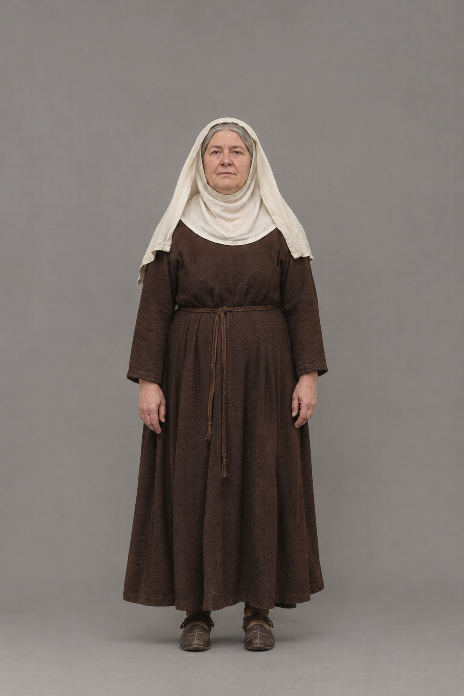
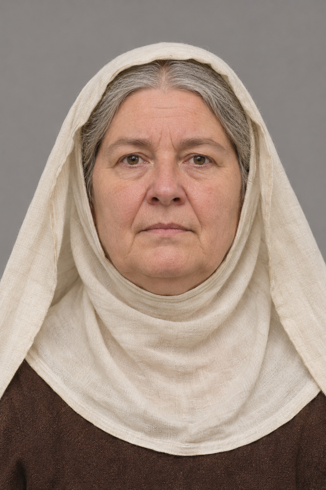

# The widow

`full.png` — Received. Visually checked against this record. Her bare hands hang clear of the brown gown below a pale veil and wimple. Selected for the user by the commissioning viewer.

`face.png` — Received. Visually checked against this record. Grey hair is visible within the ivory linen around her face. Selected for the user by the commissioning viewer.

## Appearance

### Casting description {#appearance}

58, short broad frame, grey hair under ivory linen veil and wimple; dark brown wool gown, bare hands for pole.

## Screen continuity

### In this film {#screen}

The cousins’ aunt walks on her husband’s left, at the rear of the bier as it faces the gate. Her hands are bare. In the carrying state the left rear pole rests on her right shoulder, the same corner by which the brown shoe can show beneath the linen.

### Reference directory {#references}

`media/diffusion/images/cast/widow/`
