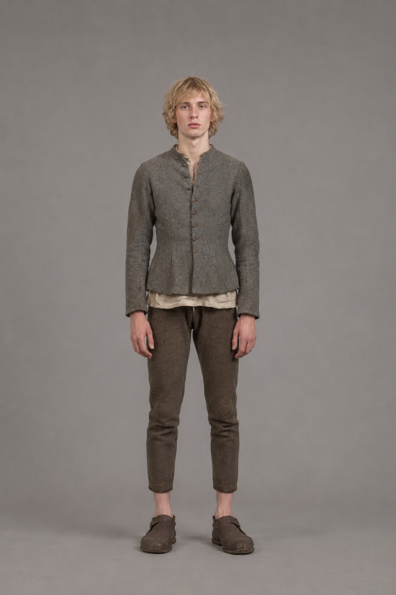
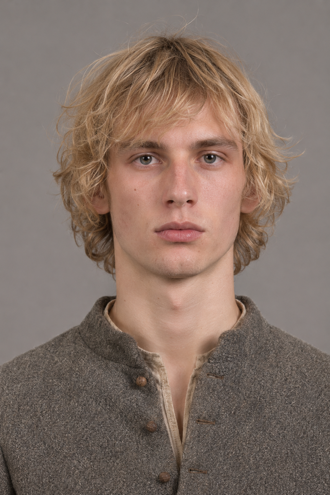

# Youngest robber

`full.png` — Received. Visually checked against this record. Both oversized brown shoes are on his feet in this standing view. Selected for the user by the commissioning viewer.

`face.png` — Received. Visually checked against this record. Light, shaggy hair falls around a narrow face. Selected for the user by the commissioning viewer.

## Appearance

### Casting description {#appearance}

20, slight long-limbed adult, shaggy flaxen hair; small grey wool doublet, oversized dark brown shoes. Left shoe comes off.

## Screen continuity

### In this film {#screen}

He is the youngest of the three adult robbers. Both shoes are oversized. The left is the loose one, and it goes back on the same foot. His shaggy flaxen head distinguishes him from the bareheaded man with black curls.

### Reference directory {#references}

`media/diffusion/images/cast/youngest/`
